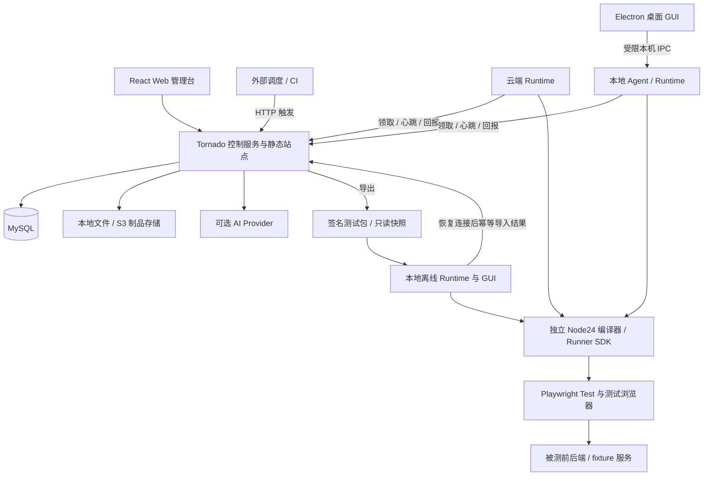
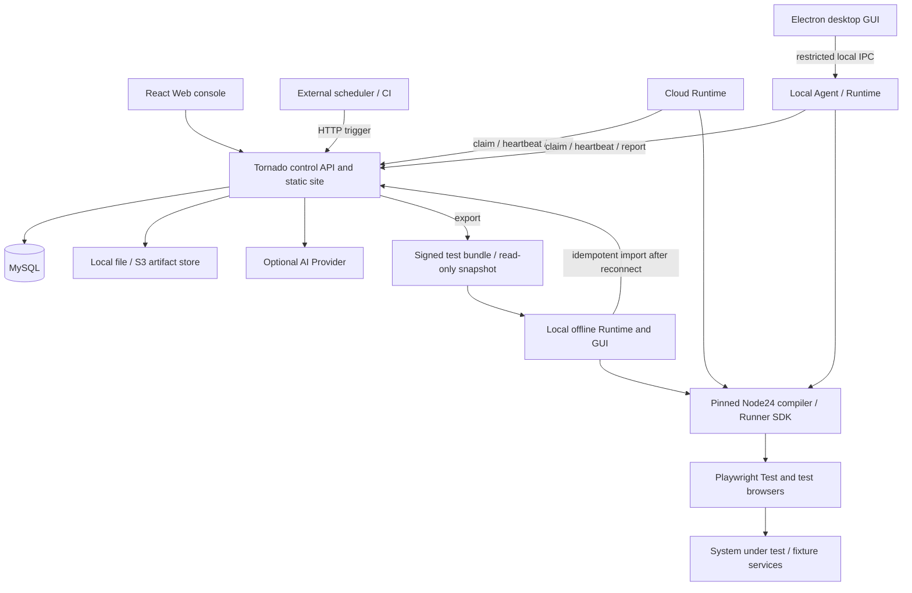

# VeriQ

面向企业 PC Web 系统的自动化冒烟与回归平台，以版本化测试资产和确定性 Playwright TypeScript 执行为核心，连接云端 Runtime、本地桌面客户端与离线执行。

**当前状态：开发中 / 尚未发布。** 账户与 Workspace、版本化测试资产、确定性编译器与 Runner SDK、fixture 与业务身份、Runtime 授权、统一队列及 Linux Agent 实际执行已有实现。八类资产编辑、编译发布、版本源码预览，以及实时结构化报告、受限证据、本机 Trace 查看、File/S3 存储与原始证据保留期维护已通过独立审查。AI 配置、预算、结构化草稿审核及失败分析已有实现并通过代码复审，实际外部 Provider 验收仍待用户授权和独立配置。签名包、可信公钥缓存、只读验证、本地凭证，以及真实离线执行、SQLite 持久化报告、取消恢复和幂等回传已通过独立复审；Electron 桌面客户端、外部触发与正式发行等工作仍在推进。目前没有正式安装包，下述功能清单是 1.0 交付目标。

仓库当前已落地 `apps/srv`（Tornado 控制服务）、`apps/web`（React 管理台）、`apps/runtime`（Agent/CLI/离线执行）、`packages/{contracts,compiler,runner-sdk,ui}`；`apps/desktop` 目前主要为 Electron 包占位，源码与发行流程仍在推进。贡献与智能体须遵循根目录 `AGENTS.md` 中的编码规范（4 空格缩进、中文注释、英文日志等）。

## 为什么做 VeriQ

VeriQ 希望让团队把页面元素、步骤、业务断言、数据和环境组织成可审阅、可发布、可复现的测试资产。运行时冻结版本与环境快照，由固定版本的 Playwright Test 执行，并保留步骤结果、请求关联、截图与 Trace。

AI 是可选辅助：用于生成结构化草稿、边界建议与失败分析，输出须经过校验和人工审核。常规执行不调用模型；未配置 Provider 时，确定性执行仍应完整可用。实际模型调用需要用户配置有效的 Provider 与凭证。

## 1.0 完整 MVP 范围

首发目标包含以下全部 14 个模块，内部研发阶段不作为完整 MVP 交付。Electron 桌面 GUI 属于首发范围，CLI 与无人值守 Agent 同时保留。

| 编号 | 模块 | 交付目标 |
| --- | --- | --- |
| F01 | 安装与系统初始化 | 部署、数据库迁移、管理员创建、配置校验、健康检查、示例资源 |
| F02 | 自有用户 | 登录/退出、邀请或管理员创建、密码重置、禁用、会话撤销 |
| F03 | Workspace | 一项目一空间、多空间成员、角色、切换、资源隔离与审计 |
| F04 | 页面与元素 | testId/role 定位、记录 key、作用域、目录版本与引用影响 |
| F05 | 用例 | 步骤与 JSON 编辑、数据驱动、变量、公共流程、草稿、校验、发布、差异与归档 |
| F06 | 操作与断言 | UI、URL、请求/响应、JSON 字段/Schema、持久化、最终一致性、模板版本与预期依据 |
| F07 | 环境与身份 | 前后端地址、域名约束、语言/时区、业务角色、凭证引用与构建版本 |
| F08 | 测试数据 | fixture 契约、隔离准备、结果查询、幂等清理与崩溃补偿 |
| F09 | Runtime | 云端/本地运行、设备注册、自检、私有/共享授权、撤销与实际进程命名 |
| F10 | 执行 | 手动与 HTTP 触发、队列、容量、租约、心跳、取消、重跑与整用例重试 |
| F11 | 报告 | 实时进度、步骤/断言差异、请求关联、截图、Trace 下载与本地查看、历史、门禁与 JUnit |
| F12 | 本地离线 | 依赖闭包导出、签名校验、本地凭证、独立执行、离线报告、幂等导入与来源标识 |
| F13 | AI 辅助 | Provider 配置与连接校验、结构化草稿、审核、失败分析、预算与调用记录 |
| F14 | 产品运维 | 同源发布、升级、备份恢复、保留期、日志指标、第三方许可、手册与验收报告 |

收费、支付、订阅、移动端、任意上传代码执行、复杂视觉基线及离线双向编辑同步不在当前确认范围内。

## 架构与运行方式

以下为目标架构。控制服务不运行浏览器测试；云端与本地共用同一套 Node 执行引擎、编译器、SDK 和结果协议。



- **云端：** Tornado 提供控制 API 和 Web 管理台，独立 Runtime 主动领取任务。服务端部署环境无需 Node、pnpm、Chrome 或 Playwright 浏览器运行条件。
- **本地桌面：** Electron + React 提供安装入口、配置登录、Workspace 与设备绑定、资源下载、执行/取消、进度、报告及诊断。React 资源随安装包本地提供，GUI 可在平台断网时打开。桌面程序不要求本机安装 Python/MySQL。
- **执行引擎：** Agent/Runner 使用独立锁定的 Node24；Electron 内嵌 Node 随 Electron 版本变化，不能视为 Node24 执行引擎。Playwright 测试浏览器与桌面 UI Chromium 分离，桌面升级不得静默改变测试引擎。
- **离线：** 下载已发布资产的依赖闭包与签名快照，验签后使用本地凭证映射执行、查看报告，恢复连接后回传结果。离线意味着无需连接控制平台，被测业务系统仍须可达；离线包不携带密码、Cookie 或设备 token，也不自动双向同步编辑。

签名包导出、信任根与本地凭证操作见[离线包说明](docs/offline-bundles.md)；离线执行、取消恢复、本地报告与回传见[操作说明](docs/offline-execution.md)。

个人 Runtime 默认私有，共享须由所有者明确授权。离线结果保留来源与信任信息；签名验证包来源和完整性，不能证明本地结果绝未被修改。断网期间无法保证远程即时取消或权限回收。

业务定时由外部调度中间件通过受限身份调用 HTTP 触发接口，执行计划不保存平台解释的 Cron。平台不内置 Cron 解析、计划扫描或 APScheduler 服务；任务轮询、租约心跳及外部触发的维护机制仍需完整实现。拟定触发接口和幂等规则见[需求与技术规格](docs/specs/veriq-1.0.md)。

## 技术基线

工程基线的精确依赖版本与许可记录见 [ADR 0003](docs/decisions/0003-engineering-baseline.md)、仓库锁文件和 [第三方声明](THIRD_PARTY_NOTICES.md)。已完成的契约检查不替代后续业务、浏览器与各目标 OS 的发布验收。

| 层次 | 目标技术 |
| --- | --- |
| 控制服务 | Python 3.12、Tornado 6.6.1 系列、SQLAlchemy 2.0、Alembic、asyncmy |
| 数据库 | MySQL 8.4 LTS |
| Web | React 18、TypeScript、Vite 6、Tailwind 3、ESM、react-router-dom 7.18.5、TanStack Query 5、Radix/CVA、i18next |
| 执行 | 独立 Node24 LTS、Playwright Test、共享编译器与 Runner SDK |
| 本地持久化 | 独立 Node24 内置 SQLite，执行占用、报告与上传状态持久化 |
| 桌面 | Electron + React、main/preload/renderer 分层、白名单类型化 IPC |
| 契约 | JSON Schema、OpenAPI、Pydantic 2、jsonschema、Ajv |
| 报告与制品 | Playwright HTML/JUnit/Trace，本地文件存储默认、S3 适配可选 |
| AI | Provider SDK 适配，按需接入 Midscene |
| 构建与测试 | pnpm、uv、build、Hatchling、pytest/pytest-asyncio、Vitest、Playwright |

目标兼容范围为服务端 Linux x64、本地 Runtime/桌面 Windows 11 x64 与 Ubuntu 24.04 x64；这些平台须分别完成真实构建与验收后才宣称支持。

## 开发检查

使用 Python 3.12.14、uv 0.13.5、Node 24.22.1 与 pnpm 11.25.0，在仓库根目录执行：

```sh
uv sync --project apps/srv --frozen --all-groups
pnpm install --frozen-lockfile
uv run --project apps/srv pytest -c apps/srv/pyproject.toml apps/srv/tests/contracts -q
pnpm test
pnpm check
```

当前 `pnpm test` 执行公共契约、编译器、Runner SDK 与 Runtime 测试（SDK 和 Runtime 自检测试需要本机 Chromium，Linux Runtime 测试还会使用开发主机的 `cc` 构建薄启动器；产品包将预编译提供），`pnpm check` 检查契约/编译器/SDK/Runtime TypeScript 与生成文件是否同步；完整平台验收入口仍待后续任务交付。这些命令用于开发检查，不是启动完整产品的安装命令。公共接口、工具配置与更多检查命令见[契约说明](docs/contracts.md)。

账户与 Workspace 模块可在开发环境运行：安全配置 MySQL、初始化管理员、分别启动 Tornado 与 Vite 的步骤见[开发指南](docs/development.md)。后端入口为 `veriq_server`；当前界面提供真实的安装、认证、用户管理、空间切换、成员与邀请功能，完整测试平台仍待后续模块交付。

版本化资产 API 支持八类资源、草稿修订、依赖、校验预览与排队、不可变发布规则。服务端已实现受信编译完成回执和发布校验，要求当前 MANAGED 设备、有效租约/fencing、批准的引擎清单及真实上传文件；Linux 开发 Agent 已接入实际编译、浏览器执行与完成回执；生产引擎清单和原生发行包仍须由发布任务交付，不会把排队任务当作已验证发布。字段与哈希协议见[契约说明](docs/contracts.md)及[资产验证决策](docs/decisions/0005-immutable-asset-validation.md)。fixture 示例、业务身份隔离、外部 TTL 补偿及受限 Trace 策略见[后端接入](docs/integration/backend.md)；当前 Attempt 凭证授权已接入真实设备、执行请求者和独立下发授权校验，原始制品与结构化报告已实施独立访问控制。AI 配置、预算、人工审核和实际 Provider 验收边界见 [AI 使用说明](docs/ai.md)。

Linux Agent 开发需先执行 `pnpm --filter @veriq/runtime build:launcher` 再 `runtime start`（Runtime 测试命令会自动构建）。该步骤仅在构建期使用 C 编译器。已安装 Agent 需要预编译的 `build/veriq_runner` 辅助进程，缺失则失败关闭。生产原生打包仍属后续发行任务；本地 Agent 运行时不要求 Python、MySQL、C 编译器、bwrap 或 unshare。

## 规划中的仓库结构

下列是**计划结构**，并非当前已实现的目录清单。桌面规格补充 `apps/desktop` 与共享 UI；早期薄原生启动器候选不替代 Electron GUI。当前仓库已实现其中大部分应用与包目录，但 `scripts/`、`deploy/`、`build.sh` 以及完整桌面源码仍可能缺失或仅部分落地。

```text
veriq/
├── apps/
│   ├── web/                       # React / Vite Web 管理台
│   ├── srv/
│   │   └── src/veriq_server/
│   │       ├── migrations/        # 随 wheel 发布
│   │       └── static/dist/       # 暂存前端产物，强制入正式 wheel
│   ├── runtime/                   # Agent、CLI 与执行监督
│   └── desktop/                   # Electron main / preload / renderer
├── packages/
│   ├── contracts/                 # JSON Schema、OpenAPI 与样例
│   ├── compiler/
│   ├── runner-sdk/
│   └── ui/                        # Web / 桌面共享组件
├── fixtures/demo-app/             # 示例业务与测试数据
├── scripts/                       # 静态产物暂存、wheel 校验与发布
├── deploy/                        # 容器、部署与外部调度示例
├── docs/
│   ├── specs/                     # 需求与桌面规格
│   ├── plans/                     # 实施计划
│   └── …                          # 决策、接入、运维与验收资料
└── build.sh                       # 规划中的构建入口
```

## 开发与生产打包约定

**开发模式：** Vite 与 Tornado 分别启动，目标端口为 5173 与 8888。Vite 代理 API 和必要事件连接，保留 HMR；Runtime 独立启动。后端 editable 安装不依赖已经存在的前端产物。

**生产模式：** 先构建 React，再将 `apps/web/dist` 暂存至 `apps/srv/src/veriq_server/static/dist`，最后构建 Python wheel。正式 wheel 必须包含完整静态资源、迁移和版本资料；缺少 `index.html` 或资源清单时构建失败。干净环境安装 wheel 后，Tornado 通过同一端口提供 API 与静态页面，服务端运行时不依赖 Node/pnpm/浏览器。

生产路由须区分 API、静态文件与登记的 SPA 页面：未知 API 和缺失静态资源返回真实 404，登记页面支持深链接刷新。凭证不得写入前端构建产物，用户证据不放入静态发布目录。

桌面安装包走独立 Windows/Linux 构建与验收流程，包含本地 GUI、Agent/Runner 及所需依赖。服务端打包成功不能代替桌面或 Windows 验证。以上为待实现的发布契约，具体步骤见[需求与技术规格](docs/specs/veriq-1.0.md)及[实施计划](docs/plans/veriq-1.0.md)。

## Workspace 与命名规则

- 产品名称为 **VeriQ**，技术标识为 `veriq`，Node 包使用 `@veriq/` 命名空间，Python 服务包使用 `veriq_server`。
- 一项目一 Workspace，用户可加入多个 Workspace；资源、证据、导出/导入及 Runtime 派单均须执行服务端空间归属与成员授权。
- 所有平台物理表使用 `veriq_` 前缀，包含迁移版本表 `veriq_alembic_version`。
- 桌面入口为 `veriq`，后台进程为 `veriq_agent`，执行进程为 `veriq_runner`；CLI 可使用 `veriq_cli` 并保留兼容入口策略。须在目标 OS 验收真实进程名，不能只改窗口标题或日志。

## 文档与参与贡献

请先阅读[1.0 需求与技术规格](docs/specs/veriq-1.0.md)、[桌面 GUI 规格](docs/specs/desktop.md)和[实施计划](docs/plans/veriq-1.0.md)。桌面规格覆盖早期仅 CLI 或薄原生启动器的过时候选。影响范围、契约或技术基线的新决策应先同步规格与 ADR，再进入实现。

贡献应包含可审阅的行为说明、相应测试与实际验证结果，并同步受影响的 Schema、OpenAPI、客户端和文档。不要以空接口、假数据页面、TODO 或默认跳过测试代替模块交付；未运行的验证须如实说明。已交付的检查入口见上文，实施计划中的其他命令须由对应任务实现并实际验证。

编码相关要求见 `AGENTS.md`：全部语言 4 空格缩进；源码注释使用中文且注释覆盖率大于 40%；公开方法与接口必须有注释；注释块首行不少于 60 个字符；日志输出使用英文。

规划中的质量门禁包括 Python/TypeScript 单测、跨语言契约样本、真实 MySQL 集成、Web/桌面 E2E、权限与故障恢复、离线与幂等回传、wheel 干净安装及各目标 OS 原生发行验收。Python 可执行代码与 TS 核心包行覆盖率目标分别不低于 75%；关键状态、权限和错误恢复仍须独立测试。构建默认完整测试，缺 MySQL/浏览器条件不得自动跳过；证据须绑定同一提交、锁文件与静态资源清单。全部 F01–F14 及桌面验收通过后，才标记 1.0 完成。

## 许可证

本项目采用 **GNU Affero General Public License v3.0（AGPL-3.0）**，完整条款见 [LICENSE](LICENSE)。第三方依赖许可将单独核验，并随发行提供 SBOM 与许可声明。

---

# VeriQ (English)

VeriQ is an automated smoke and regression platform for enterprise PC web systems. It centers on versioned test assets and deterministic Playwright TypeScript execution, and connects cloud Runtimes, a local desktop client, and offline execution.

**Current status: under development / not released.** Accounts and Workspaces, versioned test assets, the deterministic compiler and Runner SDK, fixtures and business identities, Runtime authorization, the unified queue, and real Linux Agent execution are implemented. Editing for the eight asset kinds, compile/publish, version source preview, live structured reports, restricted evidence, local Trace viewing, File/S3 storage, and raw-evidence retention maintenance have passed independent review. AI configuration, budgets, structured draft review, and failure analysis are implemented and code-reviewed; real external Provider acceptance still needs user authorization and separate configuration. Signed bundles, trusted public-key cache, read-only verification, local credentials, real offline execution, SQLite-persisted reports, cancel/resume, and idempotent upload have passed independent re-review. Electron desktop client work, external triggers, and formal releases are still in progress. There is no formal installer yet; the feature list below is the 1.0 delivery target.

The repository currently includes `apps/srv` (Tornado control service), `apps/web` (React console), `apps/runtime` (Agent/CLI/offline execution), and `packages/{contracts,compiler,runner-sdk,ui}`. `apps/desktop` is mainly an Electron package placeholder; desktop sources and release flows are still advancing. Contributors and coding agents must follow the coding standards in root `AGENTS.md` (4-space indentation, Chinese source comments, English logs, and related rules).

## Why VeriQ

VeriQ helps teams organize page elements, steps, business assertions, data, and environments into reviewable, publishable, reproducible test assets. At run time it freezes version and environment snapshots, executes with a pinned Playwright Test toolchain, and retains step results, request correlation, screenshots, and traces.

AI is optional assistance for structured drafts, boundary suggestions, and failure analysis. Outputs must be validated and human-reviewed. Routine execution does not call models; deterministic execution must remain fully usable without a configured Provider. Real model calls require a valid Provider and credentials from the user.

## Full 1.0 MVP scope

The first release targets all 14 modules below. Internal milestones are not a complete MVP. The Electron desktop GUI is in first-release scope; CLI and unattended Agent remain as well.

| ID | Module | Delivery goal |
| --- | --- | --- |
| F01 | Install and system init | Deploy, DB migration, admin bootstrap, config validation, health checks, sample resources |
| F02 | First-party users | Login/logout, invite or admin create, password reset, disable, session revoke |
| F03 | Workspace | One project per space, multi-space membership, roles, switch, isolation and audit |
| F04 | Pages and elements | testId/role locators, record keys, scopes, catalog versions and reference impact |
| F05 | Cases | Step and JSON editing, data-driven runs, variables, shared flows, draft, validate, publish, diff, archive |
| F06 | Actions and assertions | UI, URL, request/response, JSON field/Schema, persistence, eventual consistency, template versions and expected basis |
| F07 | Environments and identity | Front/back URLs, domain constraints, locale/timezone, business roles, credential refs and build versions |
| F08 | Test data | Fixture contracts, isolated prepare, result query, idempotent cleanup and crash compensation |
| F09 | Runtime | Cloud/local run, device registration, self-check, private/shared grants, revoke, real process names |
| F10 | Execution | Manual and HTTP trigger, queue, capacity, lease, heartbeat, cancel, rerun, whole-case retry |
| F11 | Reports | Live progress, step/assertion diffs, request correlation, screenshots, Trace download and local view, history, gates, JUnit |
| F12 | Local offline | Dependency-closure export, signature verify, local credentials, standalone run, offline reports, idempotent import and provenance |
| F13 | AI assistance | Provider config and connectivity check, structured drafts, review, failure analysis, budget and call records |
| F14 | Product operations | Same-origin release, upgrade, backup/restore, retention, logs/metrics, third-party notices, manuals and acceptance report |

Billing, payments, subscriptions, mobile, arbitrary uploaded-code execution, complex visual baselines, and offline bidirectional edit sync are outside the currently confirmed scope.

## Architecture and runtime model

The following is the target architecture. The control service does not run browser tests. Cloud and local share the same Node execution engine, compiler, SDK, and result protocol.



- **Cloud:** Tornado serves the control API and web console; independent Runtimes actively claim work. Server deploy environments do not need Node, pnpm, Chrome, or Playwright browser runtime prerequisites.
- **Local desktop:** Electron + React provide install entry, config/login, Workspace and device binding, asset download, run/cancel, progress, reports, and diagnostics. React assets ship with the installer; the GUI can open while disconnected from the platform. The desktop app does not require local Python/MySQL.
- **Execution engine:** Agent/Runner uses a separately pinned Node24. Electron’s embedded Node tracks Electron and must not be treated as the Node24 execution engine. Playwright test browsers stay separate from desktop UI Chromium; desktop upgrades must not silently change the test engine.
- **Offline:** Download the dependency closure and signed snapshot of published assets, verify signatures, map local credentials, execute, view reports, and upload results after reconnect. Offline means no control-plane connection; the system under test must still be reachable. Offline bundles do not carry passwords, cookies, or device tokens, and do not auto-sync edits bidirectionally.

See [offline bundles](docs/offline-bundles.md) for signed export, trust roots, and local credentials; see [offline execution](docs/offline-execution.md) for offline run, cancel/resume, local reports, and upload.

Personal Runtimes are private by default; sharing requires explicit owner authorization. Offline results retain provenance and trust metadata. Signatures prove bundle origin and integrity, not that local results were never altered. Remote instant cancel or permission revoke cannot be guaranteed while disconnected.

Business schedules are driven by external middleware calling authenticated HTTP trigger APIs. The platform does not store platform-interpreted Cron, and does not embed Cron parsing, schedule scanners, or APScheduler. Task polling, lease heartbeats, and external-trigger maintenance still must be fully implemented. Proposed trigger APIs and idempotency rules are in the [requirements and technical spec](docs/specs/veriq-1.0.md).

## Engineering baseline

Exact dependency versions and license records are in [ADR 0003](docs/decisions/0003-engineering-baseline.md), lockfiles, and [THIRD_PARTY_NOTICES.md](THIRD_PARTY_NOTICES.md). Completed contract checks do not replace later business, browser, and per-OS release acceptance.

| Layer | Target stack |
| --- | --- |
| Control service | Python 3.12, Tornado 6.6.1 series, SQLAlchemy 2.0, Alembic, asyncmy |
| Database | MySQL 8.4 LTS |
| Web | React 18, TypeScript, Vite 6, Tailwind 3, ESM, react-router-dom 7.18.5, TanStack Query 5, Radix/CVA, i18next |
| Execution | Pinned Node24 LTS, Playwright Test, shared compiler and Runner SDK |
| Local persistence | Node24 built-in SQLite for execution occupancy, reports, and upload state |
| Desktop | Electron + React, main/preload/renderer split, allowlisted typed IPC |
| Contracts | JSON Schema, OpenAPI, Pydantic 2, jsonschema, Ajv |
| Reports and artifacts | Playwright HTML/JUnit/Trace; local file storage default, optional S3 |
| AI | Provider SDK adapters, Midscene on demand |
| Build and test | pnpm, uv, build, Hatchling, pytest/pytest-asyncio, Vitest, Playwright |

Target compatibility is server Linux x64 and local Runtime/desktop on Windows 11 x64 and Ubuntu 24.04 x64. Support claims require real builds and acceptance on each platform.

## Development checks

With Python 3.12.14, uv 0.13.5, Node 24.22.1, and pnpm 11.25.0, from the repository root:

```sh
uv sync --project apps/srv --frozen --all-groups
pnpm install --frozen-lockfile
uv run --project apps/srv pytest -c apps/srv/pyproject.toml apps/srv/tests/contracts -q
pnpm test
pnpm check
```

`pnpm test` runs shared contracts, compiler, Runner SDK, and Runtime tests (SDK and Runtime doctor tests need local Chromium; Linux Runtime tests also use host `cc` to build the thin launcher; product packages will ship it prebuilt). `pnpm check` verifies contracts/compiler/SDK/Runtime TypeScript and generated files stay in sync. Full platform acceptance entry points are still pending later tasks. These commands are development checks, not a full product install. See [contracts](docs/contracts.md) for public interfaces, tooling, and additional checks.

Accounts and Workspace modules can run in development: secure MySQL setup, admin bootstrap, and separate Tornado/Vite startup are in the [development guide](docs/development.md). The backend entrypoint is `veriq_server`. The current UI provides real install, auth, user management, space switching, members, and invites; the full testing platform still needs remaining modules.

Versioned asset APIs support eight resource kinds, draft revisions, dependencies, validation preview and queueing, and immutable publish rules. The server implements trusted compile completion receipts and publish validation that require a current MANAGED device, valid lease/fencing, an approved engine manifest, and real uploaded files. The Linux development Agent is wired for real compile, browser execution, and completion receipts. Production engine manifests and native packages must still come from release tasks; queued work must not be treated as verified publish. Field and hash protocols are in [contracts](docs/contracts.md) and [immutable asset validation](docs/decisions/0005-immutable-asset-validation.md). Fixture samples, business-identity isolation, external TTL compensation, and restricted Trace policy are in [backend integration](docs/integration/backend.md). Current Attempt credential grants validate real devices, execution requesters, and independent delivery authorization; raw artifacts and structured reports already use separate access control. AI configuration, budgets, human review, and Provider acceptance boundaries are in [AI usage](docs/ai.md).

Linux Agent development requires `pnpm --filter @veriq/runtime build:launcher` before `runtime start` (the Runtime test command builds it automatically). This uses a C compiler at build time only. Installed Agents require the precompiled `build/veriq_runner` helper; missing helpers fail closed. Production native packaging remains a later release task. No Python, MySQL, C compiler, bwrap, or unshare is a local Agent runtime prerequisite.

## Planned repository layout

The tree below is the **planned** layout, not a guarantee of every directory already existing. The desktop spec adds `apps/desktop` and shared UI; early thin native launcher candidates do not replace the Electron GUI. Most app and package directories already exist; `scripts/`, `deploy/`, `build.sh`, and full desktop sources may still be missing or only partially landed.

```text
veriq/
├── apps/
│   ├── web/                       # React / Vite web console
│   ├── srv/
│   │   └── src/veriq_server/
│   │       ├── migrations/        # shipped in the wheel
│   │       └── static/dist/       # staged frontend assets required in the release wheel
│   ├── runtime/                   # Agent, CLI, and execution supervision
│   └── desktop/                   # Electron main / preload / renderer
├── packages/
│   ├── contracts/                 # JSON Schema, OpenAPI, and samples
│   ├── compiler/
│   ├── runner-sdk/
│   └── ui/                        # shared web / desktop components
├── fixtures/demo-app/             # sample business app and test data
├── scripts/                       # static staging, wheel checks, and release helpers
├── deploy/                        # containers, deploy, and external scheduler samples
├── docs/
│   ├── specs/                     # requirements and desktop specs
│   ├── plans/                     # implementation plans
│   └── …                          # decisions, integration, ops, and acceptance docs
└── build.sh                       # planned build entry
```

## Development and production packaging

**Development mode:** Vite and Tornado start separately on ports 5173 and 8888. Vite proxies API and needed event connections and keeps HMR; Runtime starts independently. Editable backend installs do not require prebuilt frontend assets.

**Production mode:** Build React first, stage `apps/web/dist` into `apps/srv/src/veriq_server/static/dist`, then build the Python wheel. The release wheel must include full static assets, migrations, and version metadata; missing `index.html` or the asset manifest fails the build. After a clean-environment wheel install, Tornado serves API and static pages on one port; the server runtime does not depend on Node/pnpm/browsers.

Production routing must distinguish API, static files, and registered SPA pages: unknown APIs and missing static assets return real 404s; registered pages support deep-link refresh. Credentials must not be baked into frontend build artifacts; user evidence must not land in the static publish directory.

Desktop installers follow separate Windows/Linux build and acceptance flows that include local GUI, Agent/Runner, and required dependencies. A successful server package does not replace desktop or Windows verification. These release contracts are still to be fully implemented; see the [requirements and technical spec](docs/specs/veriq-1.0.md) and [implementation plan](docs/plans/veriq-1.0.md).

## Workspace and naming rules

- Product name is **VeriQ**; technical id is `veriq`; Node packages use the `@veriq/` namespace; the Python service package is `veriq_server`.
- One project maps to one Workspace; users may join many Workspaces. Resources, evidence, export/import, and Runtime dispatch must enforce server-side space ownership and membership authorization.
- All platform physical tables use the `veriq_` prefix, including migration version table `veriq_alembic_version`.
- Desktop entry process is `veriq`, background process `veriq_agent`, execution process `veriq_runner`; CLI may use `veriq_cli` with a compatibility entry strategy. Real OS process names must be accepted on target OS builds; renaming only the window title or logs is not enough.

## Docs and contributing

Start with the [1.0 requirements and technical spec](docs/specs/veriq-1.0.md), [desktop GUI spec](docs/specs/desktop.md), and [implementation plan](docs/plans/veriq-1.0.md). The desktop spec supersedes earlier CLI-only or thin-native-launcher candidates. Decisions that change scope, contracts, or the engineering baseline should update specs and ADRs before implementation.

Contributions should include reviewable behavior notes, matching tests, and real verification results, and should keep affected Schema, OpenAPI, clients, and docs in sync. Do not substitute empty interfaces, fake-data pages, TODOs, or default-skipped tests for module delivery; unrun verification must be stated honestly. Delivered check entry points are above; other commands in the plan must be implemented and actually verified by their owning tasks.

Coding requirements are in `AGENTS.md`: 4-space indentation for all languages; Chinese source comments with comment coverage above 40%; public methods and interfaces must be commented; each comment block’s first line must be at least 60 characters; log output must be English.

Planned quality gates include Python/TypeScript unit tests, cross-language contract samples, real MySQL integration, web/desktop E2E, permission and failure recovery, offline and idempotent upload, clean wheel install, and native release acceptance on each target OS. Line coverage targets are at least 75% for Python executables and core TS packages; critical state, authorization, and error recovery still need dedicated tests. Builds default to full tests and must not auto-skip when MySQL/browser conditions are missing; evidence must bind the same commit, lockfiles, and static asset manifest. Mark 1.0 complete only after all F01–F14 and desktop acceptance pass.

## License

This project is licensed under the **GNU Affero General Public License v3.0 (AGPL-3.0)**; see [LICENSE](LICENSE) for the full terms. Third-party dependency licenses are verified separately and shipped with SBOM and notices.
