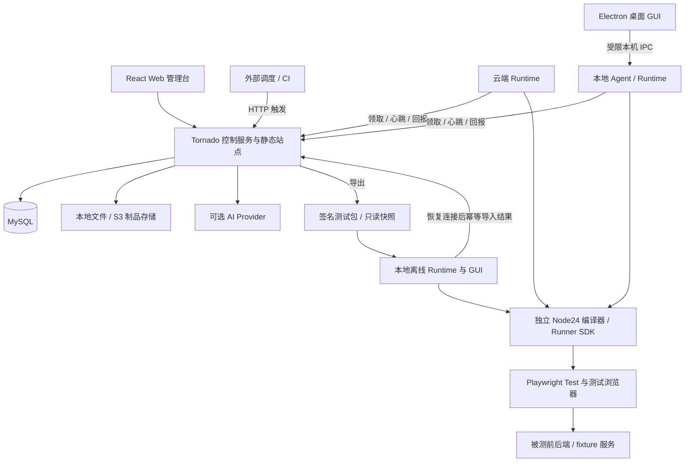

# VeriQ

面向企业 PC Web 系统的自动化冒烟与回归平台，以版本化测试资产和确定性 Playwright TypeScript 执行为核心，连接云端 Runtime、本地桌面客户端与离线执行。

**当前状态：开发中 / 尚未发布。** 当前仓库处于需求与实施规划阶段，产品代码、安装包和发布验收尚未完成。本文中的功能、目录、技术栈与交付方式描述的是 1.0 目标，不代表已经可用；目前没有可供使用的安装命令或正式下载。

## 为什么做 VeriQ

VeriQ 希望让团队把页面元素、步骤、业务断言、数据和环境组织成可审阅、可发布、可复现的测试资产。运行时冻结版本与环境快照，由固定版本的 Playwright Test 执行，并保留步骤结果、请求关联、截图与 Trace。

AI 是可选辅助：用于生成结构化草稿、边界建议与失败分析，输出须经过校验和人工审核。常规执行不调用模型；未配置 Provider 时，确定性执行仍应完整可用。实际模型调用需要用户配置有效的 Provider 与凭证。

## 1.0 完整 MVP 范围

首发目标包含以下全部 14 个模块，内部研发阶段不作为完整 MVP 交付。Electron 桌面 GUI 属于首发范围，CLI 与无人值守 Agent 同时保留。

| 编号 | 模块 | 交付目标 |
| --- | --- | --- |
| F01 | 安装与系统初始化 | 部署、数据库迁移、管理员创建、配置校验、健康检查、示例资源 |
| F02 | 自有用户 | 登录/退出、邀请或管理员创建、密码重置、禁用、会话撤销 |
| F03 | Workspace | 一项目一空间、多空间成员、角色、切换、资源隔离与审计 |
| F04 | 页面与元素 | testId/role 定位、记录 key、作用域、目录版本与引用影响 |
| F05 | 用例 | 步骤与 JSON 编辑、数据驱动、变量、公共流程、草稿、校验、发布、差异与归档 |
| F06 | 操作与断言 | UI、URL、请求/响应、JSON 字段/Schema、持久化、最终一致性、模板版本与预期依据 |
| F07 | 环境与身份 | 前后端地址、域名约束、语言/时区、业务角色、凭证引用与构建版本 |
| F08 | 测试数据 | fixture 契约、隔离准备、结果查询、幂等清理与崩溃补偿 |
| F09 | Runtime | 云端/本地运行、设备注册、自检、私有/共享授权、撤销与实际进程命名 |
| F10 | 执行 | 手动与 HTTP 触发、队列、容量、租约、心跳、取消、重跑与整用例重试 |
| F11 | 报告 | 实时进度、步骤/断言差异、请求关联、截图、Trace 下载与本地查看、历史、门禁与 JUnit |
| F12 | 本地离线 | 依赖闭包导出、签名校验、本地凭证、独立执行、离线报告、幂等导入与来源标识 |
| F13 | AI 辅助 | Provider 配置与连接校验、结构化草稿、审核、失败分析、预算与调用记录 |
| F14 | 产品运维 | 同源发布、升级、备份恢复、保留期、日志指标、第三方许可、手册与验收报告 |

收费、支付、订阅、移动端、任意上传代码执行、复杂视觉基线及离线双向编辑同步不在当前确认范围内。

## 架构与运行方式

以下为目标架构。控制服务不运行浏览器测试；云端与本地共用同一套 Node 执行引擎、编译器、SDK 和结果协议。



- **云端：** Tornado 提供控制 API 和 Web 管理台，独立 Runtime 主动领取任务。服务端部署环境无需 Node、pnpm、Chrome 或 Playwright 浏览器运行条件。
- **本地桌面：** Electron + React 提供安装入口、配置登录、Workspace 与设备绑定、资源下载、执行/取消、进度、报告及诊断。React 资源随安装包本地提供，GUI 可在平台断网时打开。桌面程序不要求本机安装 Python/MySQL。
- **执行引擎：** Agent/Runner 使用独立锁定的 Node24；Electron 内嵌 Node 随 Electron 版本变化，不能视为 Node24 执行引擎。Playwright 测试浏览器与桌面 UI Chromium 分离，桌面升级不得静默改变测试引擎。
- **离线：** 下载已发布资产的依赖闭包与签名快照，验签后使用本地凭证映射执行、查看报告，恢复连接后回传结果。离线意味着无需连接控制平台，被测业务系统仍须可达；离线包不携带密码、Cookie 或设备 token，也不自动双向同步编辑。

个人 Runtime 默认私有，共享须由所有者明确授权。离线结果保留来源与信任信息；签名验证包来源和完整性，不能证明本地结果绝未被修改。断网期间无法保证远程即时取消或权限回收。

业务定时由外部调度中间件通过受限身份调用 HTTP 触发接口，执行计划不保存平台解释的 Cron。平台不内置 Cron 解析、计划扫描或 APScheduler 服务；任务轮询、租约心跳及外部触发的维护机制仍需完整实现。拟定触发接口和幂等规则见[需求与技术规格](docs/specs/veriq-1.0.md)。

## 技术基线

以下是规格中的目标基线，精确补丁版本、依赖许可及打包工具将在 ADR 与锁文件中冻结，尚不表示依赖已安装或兼容性已验证。

| 层次 | 目标技术 |
| --- | --- |
| 控制服务 | Python 3.12、Tornado 6.6.1 系列、SQLAlchemy 2.0、Alembic、asyncmy |
| 数据库 | MySQL 8.4 LTS |
| Web | React 18、TypeScript、Vite 6、Tailwind 3、ESM、react-router-dom 7.18.5、TanStack Query 5、Radix/CVA、i18next |
| 执行 | 独立 Node24 LTS、Playwright Test、共享编译器与 Runner SDK |
| 桌面 | Electron + React、main/preload/renderer 分层、白名单类型化 IPC |
| 契约 | JSON Schema、OpenAPI、Pydantic 2、jsonschema、Ajv |
| 报告与制品 | Playwright HTML/JUnit/Trace，本地文件存储默认、S3 适配可选 |
| AI | Provider SDK 适配，按需接入 Midscene |
| 构建与测试 | pnpm、uv、build、Hatchling、pytest/pytest-asyncio、Vitest、Playwright |

目标兼容范围为服务端 Linux x64、本地 Runtime/桌面 Windows 11 x64 与 Ubuntu 24.04 x64；这些平台须分别完成真实构建与验收后才宣称支持。

## 规划中的仓库结构

下列是**计划结构**，并非当前已实现的目录清单。桌面规格补充 `apps/desktop` 与共享 UI；早期薄原生启动器候选不替代 Electron GUI。

```text
veriq/
├── apps/
│   ├── web/                       # React / Vite Web 管理台
│   ├── srv/
│   │   └── src/veriq_server/
│   │       ├── migrations/        # 随 wheel 发布
│   │       └── static/dist/       # 暂存前端产物，强制入正式 wheel
│   ├── runtime/                   # Agent、CLI 与执行监督
│   └── desktop/                   # Electron main / preload / renderer
├── packages/
│   ├── contracts/                 # JSON Schema、OpenAPI 与样例
│   ├── compiler/
│   ├── runner-sdk/
│   └── ui/                        # Web / 桌面共享组件
├── fixtures/demo-app/             # 示例业务与测试数据
├── scripts/                       # 静态产物暂存、wheel 校验与发布
├── deploy/                        # 容器、部署与外部调度示例
├── docs/
│   ├── specs/                     # 需求与桌面规格
│   ├── plans/                     # 实施计划
│   └── …                          # 决策、接入、运维与验收资料
└── build.sh                       # 规划中的构建入口
```

## 开发与生产打包约定

**开发模式：** Vite 与 Tornado 分别启动，目标端口为 5173 与 8888。Vite 代理 API 和必要事件连接，保留 HMR；Runtime 独立启动。后端 editable 安装不依赖已经存在的前端产物。

**生产模式：** 先构建 React，再将 `apps/web/dist` 暂存至 `apps/srv/src/veriq_server/static/dist`，最后构建 Python wheel。正式 wheel 必须包含完整静态资源、迁移和版本资料；缺少 `index.html` 或资源清单时构建失败。干净环境安装 wheel 后，Tornado 通过同一端口提供 API 与静态页面，服务端运行时不依赖 Node/pnpm/浏览器。

生产路由须区分 API、静态文件与登记的 SPA 页面：未知 API 和缺失静态资源返回真实 404，登记页面支持深链接刷新。凭证不得写入前端构建产物，用户证据不放入静态发布目录。

桌面安装包走独立 Windows/Linux 构建与验收流程，包含本地 GUI、Agent/Runner 及所需依赖。服务端打包成功不能代替桌面或 Windows 验证。以上为待实现的发布契约，具体步骤见[需求与技术规格](docs/specs/veriq-1.0.md)及[实施计划](docs/plans/veriq-1.0.md)。

## Workspace 与命名规则

- 产品名称为 **VeriQ**，技术标识为 `veriq`，Node 包使用 `@veriq/` 命名空间，Python 服务包使用 `veriq_server`。
- 一项目一 Workspace，用户可加入多个 Workspace；资源、证据、导出/导入及 Runtime 派单均须执行服务端空间归属与成员授权。
- 所有平台物理表使用 `veriq_` 前缀，包含迁移版本表 `veriq_alembic_version`。
- 桌面入口为 `veriq`，后台进程为 `veriq_agent`，执行进程为 `veriq_runner`；CLI 可使用 `veriq_cli` 并保留兼容入口策略。须在目标 OS 验收真实进程名，不能只改窗口标题或日志。

## 文档与参与贡献

请先阅读[1.0 需求与技术规格](docs/specs/veriq-1.0.md)、[桌面 GUI 规格](docs/specs/desktop.md)和[实施计划](docs/plans/veriq-1.0.md)。桌面规格覆盖早期仅 CLI 或薄原生启动器的过时候选。影响范围、契约或技术基线的新决策应先同步规格与 ADR，再进入实现。

贡献应包含可审阅的行为说明、相应测试与实际验证结果，并同步受影响的 Schema、OpenAPI、客户端和文档。不要以空接口、假数据页面、TODO 或默认跳过测试代替模块交付；未运行的验证须如实说明。当前尚无可执行的工程检查入口，实施计划中的命令均为待建设目标。

规划中的质量门禁包括 Python/TypeScript 单测、跨语言契约样本、真实 MySQL 集成、Web/桌面 E2E、权限与故障恢复、离线与幂等回传、wheel 干净安装及各目标 OS 原生发行验收。Python 可执行代码与 TS 核心包行覆盖率目标分别不低于 75%；关键状态、权限和错误恢复仍须独立测试。构建默认完整测试，缺 MySQL/浏览器条件不得自动跳过；证据须绑定同一提交、锁文件与静态资源清单。全部 F01–F14 及桌面验收通过后，才标记 1.0 完成。

## 许可证

本项目采用 **GNU Affero General Public License v3.0（AGPL-3.0）**，完整条款见 [LICENSE](LICENSE)。第三方依赖许可将单独核验，并随发行提供 SBOM 与许可声明。
