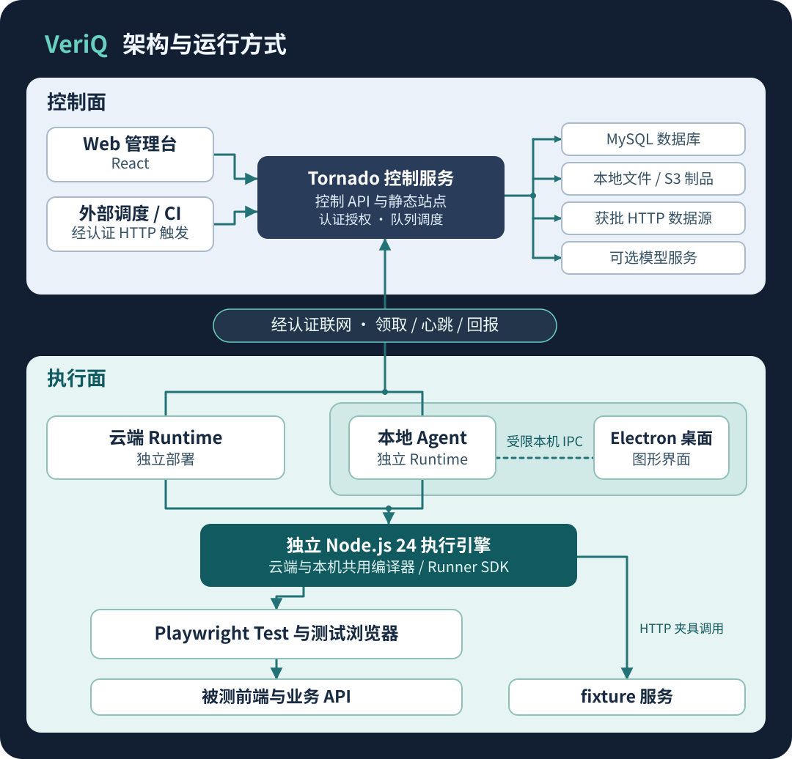

<p align="center">
    <picture>
        <source media="(prefers-color-scheme: dark)" srcset="assets/branding/verifyquality-logo-dark.svg">
        
    </picture>
</p>

# VeriQ

VeriQ 可拆读为 Veri（验证）与 Q（质量），表达用可复现的验证支撑软件质量。

## 0. 目录

1. [项目背景与目标](#1-项目背景与目标)
2. [架构说明](#2-架构说明)
3. [技术栈及选型](#3-技术栈及选型)
4. [仓库结构](#4-仓库结构)
5. [许可证说明](#5-许可证说明)
6. [产品功能白皮书](#6-产品功能白皮书)

## 1. 项目背景与目标

VeriQ 面向企业桌面端 Web 系统的自动化冒烟与回归测试。这类测试跨越界面、业务接口、身份和数据。脚本或环境变更后，团队需要确认测试使用的输入版本，并依据步骤证据定位失败。

VeriQ 的目标是让测试可复现、结果可追溯。团队可将页面元素、操作、断言、数据和环境组织为可审阅、可发布的资产。执行时冻结资产版本和环境快照，使用固定的浏览器工具链并记录步骤结果。

**开发中，尚未正式发布。** 账户与工作区、资产编译和发布、联网执行与报告已有实现。服务端正式发行、桌面原生安装及全仓质量门禁仍待完成。以下知识库链接需要 VeriQ-Knowledge 的访问权限。[文档索引](https://github.com/baofengbaofeng/VeriQ-Knowledge/blob/master/%E6%96%87%E6%A1%A3%E7%B4%A2%E5%BC%95.md) · [开发指南](https://github.com/baofengbaofeng/VeriQ-Knowledge/blob/master/%E5%BC%80%E5%8F%91%E6%8C%87%E5%8D%97.md) · [首版验证交接](https://github.com/baofengbaofeng/VeriQ-Knowledge/blob/master/validation/%E9%A6%96%E7%89%88%E9%AA%8C%E8%AF%81%E4%BA%A4%E6%8E%A5.md)

macOS 双架构已有部分专项证据，涵盖官方资产处理、生产依赖布局采集及私有凭据存储。原生发行与目标安装仍有独立验收事项。[运行时组装验收](https://github.com/baofengbaofeng/VeriQ-Knowledge/blob/master/validation/tasks/%E8%BF%90%E8%A1%8C%E6%97%B6%E5%8F%91%E8%A1%8C%E4%B8%8E%E7%BB%84%E8%A3%85%E9%AA%8C%E6%94%B6.md) · [macOS 凭据存储验收](https://github.com/baofengbaofeng/VeriQ-Knowledge/blob/master/testing/macos-keychain.md)

## 2. 架构说明



- **控制服务**由 Tornado 提供 API、身份与工作区授权、队列和报告。生产部署将构建好的 React 管理台随 Python wheel 同源分发。MySQL 保存平台状态，制品支持本地文件和 S3 兼容存储。浏览器测试交由独立运行时执行，生产控制服务无需安装 Node.js 或测试浏览器。
- **执行运行时**在云端或用户设备上通过独立 Agent 领取任务、维持租约并回传结果。Runner 使用固定的 Node.js 与 Playwright 工具链直接访问被测系统。平台失联后，按租约停止执行并清理。
- **桌面工作台**使用 Electron 与 React，提供登录、设备绑定、执行进度、报告与诊断。界面通过受限 IPC 与宿主交互，测试引擎独立于 Electron 内置的 Node.js 和 Chromium。[桌面工作台指南](https://github.com/baofengbaofeng/VeriQ-Knowledge/blob/master/%E6%A1%8C%E9%9D%A2%E5%B7%A5%E4%BD%9C%E5%8F%B0%E6%8C%87%E5%8D%97.md)
- **外部调度和持续集成**通过受限服务令牌调用幂等 HTTP 接口，触发执行计划、检查门禁并运行有界维护。计划计时由外部调度器负责。[外部调度接入](https://github.com/baofengbaofeng/VeriQ-Knowledge/blob/master/integration/%E5%A4%96%E9%83%A8%E8%B0%83%E5%BA%A6%E6%8E%A5%E5%85%A5.md)

服务端目标为 Linux x64。桌面与 Runtime 优先交付 macOS 15 及以上的 Intel x64 和 Apple Silicon arm64，也保留 Windows 11 x64 和 Ubuntu 24.04 x64。各平台分别构建并验收。[运行时发行与原生边界](https://github.com/baofengbaofeng/VeriQ-Knowledge/blob/master/decisions/0021-%E8%BF%90%E8%A1%8C%E6%97%B6%E5%8F%91%E8%A1%8C%E4%B8%8E%E5%8E%9F%E7%94%9F%E8%BE%B9%E7%95%8C.md) · [服务端发行指南](https://github.com/baofengbaofeng/VeriQ-Knowledge/blob/master/%E6%9C%8D%E5%8A%A1%E7%AB%AF%E5%8F%91%E8%A1%8C%E6%8C%87%E5%8D%97.md)

## 3. 技术栈及选型

| 层次 | 技术 | 选型依据 |
| --- | --- | --- |
| 控制服务 | Python 3.12、Tornado 6.6.1、SQLAlchemy 2、Alembic、asyncmy | 使用异步 HTTP 和数据库访问处理接口、执行事件与维护请求，复用成熟的事务和迁移工具。 |
| 平台数据库 | MySQL 8.4 LTS | 使用 InnoDB 事务与并发控制保存成员授权、不可变版本、租约及执行状态。 |
| 网页管理台 | React 18、TypeScript、Vite 6、Tailwind CSS 3、React Router 7.18.5、TanStack Query、Radix、CVA | 使用固定版本的前端工具链，复用请求缓存、可访问控件和样式变体，支撑开发热更新及同源静态发布。 |
| 浏览器执行 | 独立 Node.js 24、Playwright 1.65.0、共享编译器与 Runner SDK | 云端和本地使用同一套编译与执行协议。固定浏览器工具链便于复现测试并保存 Trace。 |
| 桌面与本地状态 | Electron 45.3.1、React、Node.js 内置 SQLite | 复用网页组件，通过主进程和预加载层约束宿主能力，以本地持久化支持运行恢复和报告读取。 |
| 公共契约 | JSON Schema、OpenAPI、Pydantic、jsonschema、Ajv | 共享资源和协议定义，校验 Python 与 TypeScript 调用方并生成前端类型。 |
| 模型辅助 | OpenAI 与 Anthropic SDK，经服务端适配器调用 | 按工作区控制模型服务的授权、预算、上下文与审核。确定性执行可独立运行。 |
| 构建与测试 | pnpm、uv、Hatchling、pytest、Vitest、Playwright | 冻结依赖，按契约、应用和平台场景验证，再组装 Python wheel 与目标发行候选。 |

工程约束、原生运行边界与组件选型分别见 [ADR 0003](https://github.com/baofengbaofeng/VeriQ-Knowledge/blob/master/decisions/0003-%E5%B7%A5%E7%A8%8B%E5%9F%BA%E7%BA%BF.md)、[ADR 0021](https://github.com/baofengbaofeng/VeriQ-Knowledge/blob/master/decisions/0021-%E8%BF%90%E8%A1%8C%E6%97%B6%E5%8F%91%E8%A1%8C%E4%B8%8E%E5%8E%9F%E7%94%9F%E8%BE%B9%E7%95%8C.md) 和 [ADR 0024](https://github.com/baofengbaofeng/VeriQ-Knowledge/blob/master/decisions/0024-%E7%BD%91%E9%A1%B5%E7%95%8C%E9%9D%A2%E4%BE%9D%E8%B5%96.md)。精确版本与分发物摘要见 [pnpm 锁文件](pnpm-lock.yaml)和 [Python 锁文件](apps/srv/uv.lock)。

## 4. 仓库结构

```text
VeriQ/
├── apps/
│   ├── srv/              # Python 控制服务、数据库迁移与静态资源打包
│   ├── web/              # React 网页管理台
│   ├── runtime/          # 联网 Agent、Runner、命令行及原生平台适配
│   └── desktop/          # Electron 主进程、预加载层与桌面界面
├── packages/
│   ├── contracts/        # 共享 Schema、OpenAPI 与契约样例
│   ├── compiler/         # 测试资产校验与确定性编译
│   ├── runner-sdk/       # Playwright 执行与运行事件
│   └── ui/               # 网页与桌面共享组件
├── assets/               # 项目标志与架构图
├── fixtures/             # 示例业务、工作区资产和测试夹具
├── tests/                # 端到端与验收套件
├── scripts/              # 构建、引擎、校验与持续集成工具
├── deploy/               # 部署脚本与服务配置
└── build.sh              # 服务端构建与发行检查入口
```

本地开发按开发指南准备工具链、数据库和锁定依赖。贡献者按仓库约定提交代码与实际验证证据。[开发指南](https://github.com/baofengbaofeng/VeriQ-Knowledge/blob/master/%E5%BC%80%E5%8F%91%E6%8C%87%E5%8D%97.md) · [工程基线](https://github.com/baofengbaofeng/VeriQ-Knowledge/blob/master/decisions/0003-%E5%B7%A5%E7%A8%8B%E5%9F%BA%E7%BA%BF.md)

## 5. 许可证说明

VeriQ 采用 **GNU Affero 通用公共许可证第 3 版（AGPL-3.0）**。如果修改后的版本支持通过计算机网络远程交互，许可证第 13 条要求向所有与该版本远程交互的用户显著提供获取对应源代码的机会，并通过网络服务器免费提供访问。[许可证原文](LICENSE)

第三方组件分别适用上游许可证。发行时须按实际交付内容核验第三方许可、版权归属和随附声明，并提供相应的软件物料清单。[第三方声明](THIRD_PARTY_NOTICES.md) · [依赖清单与审计记录](https://github.com/baofengbaofeng/VeriQ-Knowledge/blob/master/dependencies/README.md)

## 6. 产品功能白皮书

以下功能为首版交付范围，适用于网页管理台、桌面客户端与独立运行时的相应场景。首版执行须连接平台，历史签名包元数据和已有历史报告保留兼容读取。功能的实现和验收状态按任务记录。[公共契约](https://github.com/baofengbaofeng/VeriQ-Knowledge/blob/master/%E5%85%AC%E5%85%B1%E5%A5%91%E7%BA%A6.md#%E8%81%94%E7%BD%91%E4%BB%BB%E5%8A%A1%E7%9A%84%E8%AF%81%E6%8D%AE%E4%B8%8E%E6%81%A2%E5%A4%8D) · [需求验收矩阵](https://github.com/baofengbaofeng/VeriQ-Knowledge/blob/master/validation/%E9%9C%80%E6%B1%82%E9%AA%8C%E6%94%B6%E7%9F%A9%E9%98%B5.md)

### 账户与工作区

支持员工账户登录、退出、邀请或管理员创建、密码重置、停用及会话撤销。按项目划分工作区，成员可在获授权的工作区之间切换。资源、凭据、证据及设备派单由服务端按工作区和当前角色授权，关键变更可审计。[用户与运维指南](https://github.com/baofengbaofeng/VeriQ-Knowledge/blob/master/guides/%E7%94%A8%E6%88%B7%E4%B8%8E%E8%BF%90%E7%BB%B4%E6%8C%87%E5%8D%97.md)

### 测试资产与业务断言

以页面、元素及目录组织定位，支持稳定标记、可访问角色、记录键、作用域和版本引用检查。用例支持步骤与 JSON 编辑、变量、公共流程及数据驱动，校验后发布不可变版本，并可比较差异或归档。断言覆盖界面、URL、请求与响应、JSON 字段及 Schema、持久化与最终一致性。复用断言模板时保留其版本及预期依据。[资源文档与 DSL](https://github.com/baofengbaofeng/VeriQ-Knowledge/blob/master/%E5%85%AC%E5%85%B1%E5%A5%91%E7%BA%A6.md#resource-documents-and-dsl)

### 环境、业务身份与测试数据

环境版本固定前后端地址、访问域名、语言、时区、业务角色、凭据引用和目标构建。数据集提供版本化静态输入，命名参考数据也可通过获批的 HTTP 数据源读取。Fixture 支持隔离准备、结果查询、幂等清理和崩溃补偿。[系统接入规范](https://github.com/baofengbaofeng/VeriQ-Knowledge/blob/master/integration/%E7%B3%BB%E7%BB%9F%E6%8E%A5%E5%85%A5%E8%A7%84%E8%8C%83.md)

### 设备、队列与运行

支持云端和本地设备登记、自检、私人使用、显式共享及撤销，原生部署按目标系统核对真实进程名。执行可手动或通过 HTTP 触发，统一管理队列、容量、任务领取、租约、心跳、取消和重跑。符合条件的整用例重试由 VeriQ 编排。重试后通过时，汇总计入 `UNSTABLE`，每次尝试保留实际结果。[执行协议](https://github.com/baofengbaofeng/VeriQ-Knowledge/blob/master/%E5%85%AC%E5%85%B1%E5%A5%91%E7%BA%A6.md#claim-leases-and-job-manifests)

### 报告、证据与持续集成门禁

查看实时进度、步骤和断言差异、请求关联、截图、Trace 与历史。原始证据按当前权限受限下载，Trace 可在本机查看。持续集成读取终态、门禁结论与 JUnit 结果。[报告、证据与诊断](https://github.com/baofengbaofeng/VeriQ-Knowledge/blob/master/%E5%85%AC%E5%85%B1%E5%A5%91%E7%BA%A6.md#t12-reports-evidence-and-diagnostics)

### 模型辅助

按工作区配置模型服务和预算，支持连接校验、结构化草稿、边界建议、失败分析和调用记录。模型输出须经校验与人工审核，资产仍由授权人员按正常流程发布。[模型辅助使用指南](https://github.com/baofengbaofeng/VeriQ-Knowledge/blob/master/%E6%A8%A1%E5%9E%8B%E8%BE%85%E5%8A%A9%E4%BD%BF%E7%94%A8%E6%8C%87%E5%8D%97.md)

### 安装、发布与运维

安装流程涵盖数据库迁移、首位管理员、配置校验、健康检查及示例资源。发行与日常运维涵盖同源部署、升级和回滚、备份恢复、证据保留期、日志和指标、第三方声明、操作手册及验收记录。[服务端发行指南](https://github.com/baofengbaofeng/VeriQ-Knowledge/blob/master/%E6%9C%8D%E5%8A%A1%E7%AB%AF%E5%8F%91%E8%A1%8C%E6%8C%87%E5%8D%97.md) · [验证与验收索引](https://github.com/baofengbaofeng/VeriQ-Knowledge/blob/master/validation/%E9%AA%8C%E8%AF%81%E4%B8%8E%E9%AA%8C%E6%94%B6%E7%B4%A2%E5%BC%95.md)
