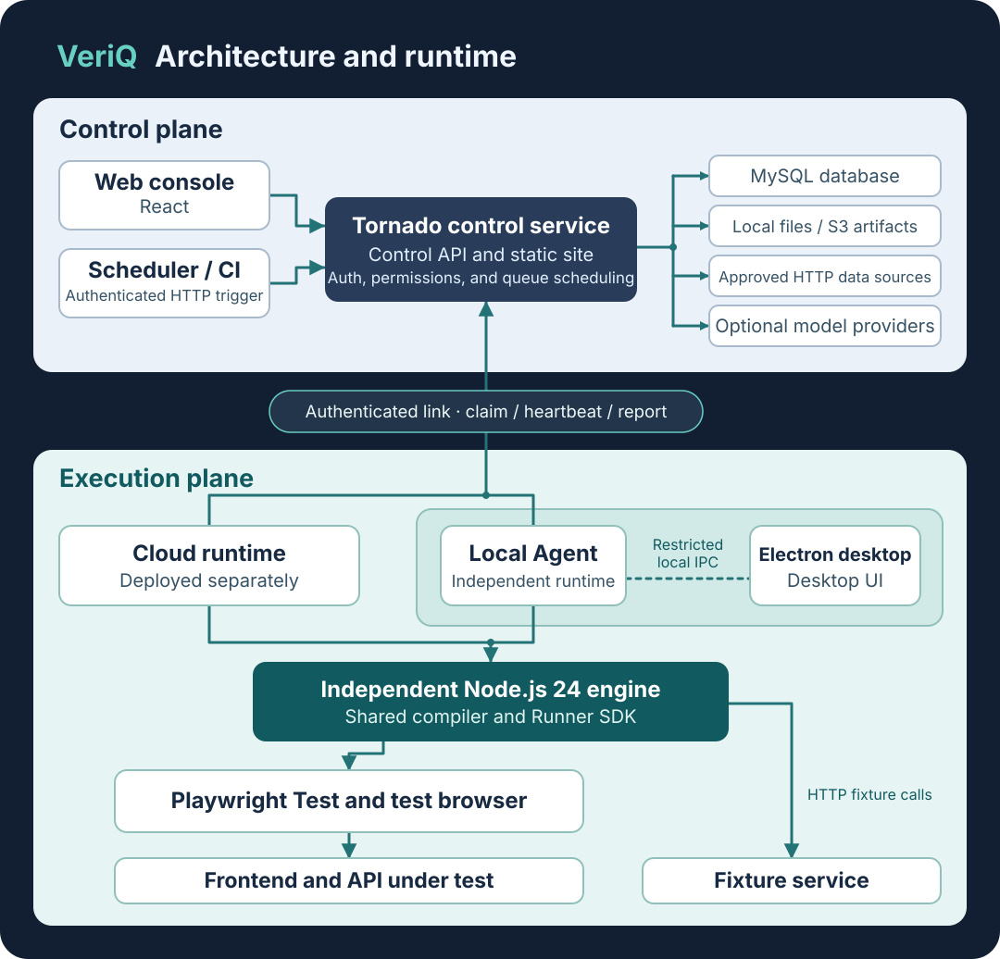

<p align="center">
    
</p>

# VeriQ

The name VeriQ can be read as Veri for verification and Q for quality. It reflects the goal of using reproducible verification to support software quality.

[简体中文](README.md) · **English** · [日本語](README_JP.md)

[](.python-version) [](apps/srv/pyproject.toml) [](apps/web/package.json) [](.node-version)

[](apps/desktop/package.json) [](apps/runtime/package.json) [](docs/decisions/0003-工程基线.md)

## 0. Contents

1. [Project Background and Goals](#1-project-background-and-goals)
2. [Architecture](#2-architecture)
3. [Technology Stack and Rationale](#3-technology-stack-and-rationale)
4. [Repository Structure](#4-repository-structure)
5. [License](#5-license)
6. [Product Feature White Paper](#6-product-feature-white-paper)

## 1. Project Background and Goals

VeriQ automates smoke and regression testing for enterprise web applications used on desktop computers. These tests span the user interface, business APIs, identity, and data. When a test script or environment changes, teams need to know which input versions a run used and see evidence from individual steps to locate failures.

VeriQ aims to make tests reproducible and results traceable. Teams can organize page elements, actions, assertions, data, and environments into test assets they can review and publish. Each run freezes its asset versions and environment snapshot, uses a pinned browser toolchain, and records step results.

**In development, with no official release yet.** Accounts and workspaces, asset compilation and publishing, connected execution, and reporting are implemented. The production server release, native desktop installation, and repository-wide quality gates are still pending. [Documentation index](docs/README.md) · [Development guide](docs/开发指南.md) · [First-release validation handoff](docs/validation/首版验证交接.md)

Some focused validation evidence is available for both macOS architectures, covering processing of official assets, capture of the production dependency layout, and tests of private credential storage. The native release and installation on target systems still have separate acceptance requirements. [Asset processing run](https://github.com/baofengbaofeng/VeriQ/actions/runs/43740087046) · [Dependency layout run](https://github.com/baofengbaofeng/VeriQ/actions/runs/43770719879) · [Private storage run](https://github.com/baofengbaofeng/VeriQ/actions/runs/43758515194)

## 2. Architecture



- The **control service** uses Tornado for APIs, identity and workspace authorization, queues, and reporting. In production, the built React console ships in the Python wheel and is served from the same origin as the API. MySQL stores platform state, and artifacts can use local files or S3-compatible storage. Independent runtimes run browser tests, so production control servers can run without Node.js or test browsers.
- The **execution runtime** uses a standalone Agent on a cloud host or user device to claim work, maintain its lease, and report results. The Runner uses pinned Node.js and Playwright versions to reach the system under test directly. If it loses its connection to the platform, it stops and cleans up execution according to the lease.
- The **desktop workspace** uses Electron and React to provide sign-in, device binding, run progress, reports, and diagnostics. The interface talks to the host over restricted IPC. The test engine runs independently of Electron's embedded Node.js and Chromium. [Desktop workspace guide](docs/桌面工作台指南.md)
- **External scheduling and CI** use scoped service tokens to call idempotent HTTP endpoints for triggering execution plans, checking quality gates, and running bounded maintenance tasks. The external scheduler determines when plans run. [External scheduling integration](docs/integration/外部调度接入.md)

The server targets Linux x64. Desktop and Runtime delivery prioritizes macOS 15 or later on Intel x64 and Apple Silicon arm64. Windows 11 x64 and Ubuntu 24.04 x64 remain in scope. Each platform requires a separate build and acceptance run. [Runtime distribution and native boundaries](docs/decisions/0021-运行时发行与原生边界.md) · [Server release guide](docs/服务端发行指南.md)

## 3. Technology Stack and Rationale

| Layer | Technology | Rationale |
| --- | --- | --- |
| Control service | Python 3.12, Tornado 6.6.1, SQLAlchemy 2, Alembic, asyncmy | Asynchronous HTTP and database access handle API calls, execution events, and maintenance requests while reusing mature transaction and migration tools. |
| Platform database | MySQL 8.4 LTS | InnoDB transactions and concurrency controls protect membership grants, immutable versions, leases, and execution state. |
| Web console | React 18, TypeScript, Vite 6, Tailwind CSS 3, React Router 7.18.5, TanStack Query, Radix, CVA | The pinned frontend toolchain provides query caching, accessible controls, and style variants, with hot updates in development and same-origin static delivery in production. |
| Browser execution | Standalone Node.js 24, Playwright 1.65.0, shared compiler and Runner SDK | Cloud and local runtimes use the same compilation and execution protocols. Pinning the browser toolchain helps reproduce tests and preserve traces. |
| Desktop and local state | Electron 45.3.1, React, SQLite built into Node.js | Share web components, restrict host capabilities through the main process and preload layer, and persist local state for run recovery and report access. |
| Shared contracts | JSON Schema, OpenAPI, Pydantic, jsonschema, Ajv | Share resource and protocol definitions, validate inputs across Python and TypeScript, and generate frontend types. |
| AI assistance | OpenAI and Anthropic SDKs through server-side adapters | Control model access, budgets, context, and review per workspace. Deterministic execution can run independently. |
| Build and tests | pnpm, uv, Hatchling, pytest, Vitest, Playwright | Freeze dependencies and verify contract, application, and platform scenarios before assembling Python wheels and target release candidates. |

Engineering constraints, native runtime boundaries, and web component choices are documented in the architecture decisions. The lockfiles record exact dependency versions and distribution digests. [ADR 0003](docs/decisions/0003-工程基线.md) · [ADR 0021](docs/decisions/0021-运行时发行与原生边界.md) · [ADR 0024](docs/decisions/0024-网页界面依赖.md) · [pnpm lockfile](pnpm-lock.yaml) · [Python lockfile](apps/srv/uv.lock)

## 4. Repository Structure

```text
VeriQ/
├── apps/
│   ├── srv/              # Python control service, database migrations, and static asset packaging
│   ├── web/              # React web console
│   ├── runtime/          # Connected Agent, Runner, CLI, and native platform adapters
│   └── desktop/          # Electron main process, preload layer, and desktop interface
├── packages/
│   ├── contracts/        # Shared schemas, OpenAPI specification, and contract examples
│   ├── compiler/         # Test asset validation and deterministic compilation
│   ├── runner-sdk/       # Playwright execution and run events
│   └── ui/               # Shared web and desktop components
├── assets/               # Project logo and architecture graphics
├── docs/                 # Project documentation, decisions, integration specs, and acceptance records
├── fixtures/             # Sample application, workspace assets, and test fixtures
├── tests/                # End-to-end and acceptance suites
├── scripts/              # Build, engine, verification, and CI tools
├── deploy/               # Deployment scripts, service configuration, and operations material
├── .github/workflows/    # CI and platform verification workflows
├── .agents/rules/        # Coding, testing, security, and release standards
├── build.sh              # Server build and release checks
└── AGENTS.md             # Working agreements for contributors and coding agents
```

The development guide covers setting up the toolchain, database, and pinned dependencies. Contributors submit code and evidence from the checks they actually ran under the repository's contribution rules. [Development guide](docs/开发指南.md) · [Contributor rules](AGENTS.md)

## 5. License

VeriQ uses the **GNU Affero General Public License, version 3 (AGPL-3.0)**. If you modify VeriQ and your version supports remote interaction over a computer network, Section 13 requires it to prominently offer every user interacting with it remotely access to its Corresponding Source at no charge from a network server. [License text](LICENSE)

Third-party components are governed by their upstream licenses. For each release, verify the third-party licenses, copyright attributions, and notices for the components actually shipped, and provide the corresponding software bill of materials. [Third-party notices](THIRD_PARTY_NOTICES.md) · [Dependency inventories and audits](docs/dependencies/README.md)

## 6. Product Feature White Paper

The following features define the first-release scope across the web console, desktop client, and standalone runtime. Execution in the first release requires a platform connection. Metadata from historical signed bundles and existing reports remain readable for compatibility. Implementation and acceptance status are tracked by task. [Public contracts](docs/公共契约.md#联网任务的证据与恢复) · [Requirements acceptance matrix](docs/validation/需求验收矩阵.md)

### Accounts and Workspaces

Employee accounts support sign-in, sign-out, invitations or administrator creation, password reset, account disabling, and session revocation. Each project has a workspace, and members can switch between workspaces they are authorized to access. The server authorizes access to resources, credentials, and evidence, as well as work dispatch to devices, based on the workspace and current role. Key changes can be audited. [User and operator guide](docs/guides/用户与运维指南.md)

### Test Assets and Business Assertions

Organize locators by page, element, and catalog using stable identifiers, accessibility roles, record keys, scopes, and version reference checks. Test cases support step and JSON editing, variables, shared flows, and data-driven execution. Validated cases can be published as immutable versions, compared, or archived. Assertions cover the UI, URLs, HTTP requests and responses, JSON fields and schemas, persistence, and eventual consistency. Reusing an assertion template preserves its version and the basis for its expected values. [Resource documents and DSL](docs/公共契约.md#resource-documents-and-dsl)

### Environments, Business Identity, and Test Data

Environment versions pin frontend and backend URLs, allowed domains, language, time zone, business roles, credential references, and the target build. Datasets supply versioned static input. Approved HTTP data sources can also supply named reference data. Fixtures support isolated preparation, result queries, idempotent cleanup, and compensation after crashes. [System integration specs](docs/integration/系统接入规范.md)

### Devices, Queues, and Runs

Cloud and local devices support enrollment, diagnostics, private use, explicit sharing, and revocation. Native deployments verify actual process names on the target system. Runs can be triggered manually or over HTTP, with shared controls for queues, capacity, task claims, leases, heartbeats, cancellation, and reruns. VeriQ orchestrates eligible whole-test retries. A passing retry contributes `UNSTABLE` to the aggregate result, with each attempt retaining its actual outcome. [Execution protocols](docs/公共契约.md#claim-leases-and-job-manifests)

### Reports, Evidence, and CI Gates

View live progress, step and assertion diffs, request correlation, screenshots, traces, and run history. Downloading raw evidence requires current authorization, and traces can be viewed locally. CI reads final run states, gate results, and JUnit results. [Reports, evidence, and diagnostics](docs/公共契约.md#t12-reports-evidence-and-diagnostics)

### AI Assistance

Configure model providers and budgets per workspace. Validate provider connectivity, generate structured drafts, explore boundary cases, analyze failures, and review call history. Model outputs require validation and human review. Authorized users still publish assets through the standard workflow. [AI assistance guide](docs/模型辅助使用指南.md)

### Installation, Releases, and Operations

Installation covers database migrations, the first administrator account, configuration validation, health checks, and sample resources. Release and operations work covers same-origin deployment, upgrades and rollback, backup and restore, evidence retention, logs and metrics, third-party notices, manuals, and acceptance records. [Server release guide](docs/服务端发行指南.md) · [Verification and acceptance index](docs/validation/验证与验收索引.md)
