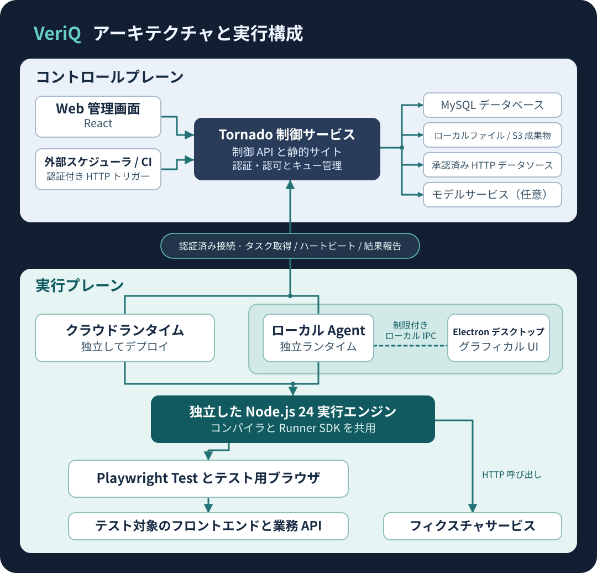

<p align="center">
    
</p>

# VeriQ

VeriQ という名前は、Veri（検証）と Q（品質）に分けて読むことができます。再現可能な検証でソフトウェアの品質を支えるという考え方を表しています。

[简体中文](README.md) · [English](README_EN.md) · **日本語**

## 0. 目次

1. [プロジェクトの背景と目的](#1-プロジェクトの背景と目的)
2. [アーキテクチャ](#2-アーキテクチャ)
3. [技術スタックと選定理由](#3-技術スタックと選定理由)
4. [リポジトリ構成](#4-リポジトリ構成)
5. [ライセンス](#5-ライセンス)
6. [製品機能ホワイトペーパー](#6-製品機能ホワイトペーパー)

## 1. プロジェクトの背景と目的

VeriQ は、企業向けのデスクトップ用 Web システムを対象に、スモークテストと回帰テストを自動化します。これらのテストは画面、業務 API、ユーザーの認証・権限、データにまたがります。スクリプトや環境を変更した後、チームはテストに使われた入力のバージョンを確認し、各ステップの証跡をもとに失敗箇所を特定する必要があります。

VeriQ の目的は、テストを再現し、結果を追跡できるようにすることです。ページ要素、操作、アサーション、データ、環境を、レビューと公開が可能なテスト資産として管理できます。実行時には資産のバージョンと環境のスナップショットを固定し、バージョンを固定したブラウザツールチェーンで各ステップの結果を記録します。

**開発中で、正式版は未リリースです。** アカウントとワークスペース、テスト資産のコンパイルと公開、プラットフォーム接続時の実行とレポートは実装済みです。サーバーの正式リリース、デスクトップのネイティブインストール、リポジトリ全体の品質ゲートは整備中です。[ドキュメント一覧](docs/README.md) · [開発ガイド](docs/开发指南.md) · [初版の検証引き継ぎ](docs/validation/首版验证交接.md)

macOS の両アーキテクチャでは、公式配布物の取り扱い、本番環境での依存関係の配置の記録、非公開の認証情報ストレージについて、一部の検証結果が得られています。ネイティブ版のリリースと対象環境でのインストールには、それぞれ未完了の受け入れ項目があります。[配布物の検証記録](https://github.com/baofengbaofeng/VeriQ/actions/runs/43740087046) · [依存関係の配置の検証記録](https://github.com/baofengbaofeng/VeriQ/actions/runs/43770719879) · [非公開ストレージの検証記録](https://github.com/baofengbaofeng/VeriQ/actions/runs/43758515194)

## 2. アーキテクチャ



- **制御サービス**は Tornado ベースで、API、認証とワークスペースの認可、キュー、レポートを提供します。本番ではビルド済みの React 管理コンソールを Python wheel に同梱し、API と同じオリジンで配信します。プラットフォームの状態は MySQL に保存し、成果物の保存先にはローカルファイルまたは S3 互換ストレージを使えます。ブラウザテストは独立したランタイムが実行するため、本番の制御サービスに Node.js やテスト用ブラウザをインストールする必要はありません。
- **実行ランタイム**はクラウドまたはユーザーのデバイス上で動作します。独立した Agent がジョブを取得し、リースを維持して結果を返します。Runner はバージョンを固定した Node.js と Playwright でテスト対象システムに直接アクセスします。プラットフォームとの接続が切れた場合は、リースに従って実行を停止し、後処理を行います。
- **デスクトップコンソール**は Electron と React を使用し、ログイン、デバイスの紐付け、実行状況、レポート、診断を提供します。画面は制限付き IPC を通じてホストと通信します。テストエンジンは、Electron に内蔵された Node.js や Chromium から独立しています。[デスクトップコンソールガイド](docs/桌面工作台指南.md)
- **外部スケジューリングと継続的インテグレーション（CI）**では、権限を限定したサービストークンで冪等な HTTP API を呼び出し、実行計画の開始、ゲート判定の確認、範囲を限定した保守処理を行います。実行時刻は外部スケジューラーが管理します。[外部スケジューラーとの連携](docs/integration/外部调度接入.md)

サーバーの対象は Linux x64 です。デスクトップと Runtime は macOS 15 以降の Intel x64 と Apple Silicon arm64 を優先し、Windows 11 x64 と Ubuntu 24.04 x64 も対象に含みます。ビルドと受け入れ検証はプラットフォームごとに行います。[ランタイムのリリースとネイティブ機能の境界](docs/decisions/0021-运行时发行与原生边界.md) · [サーバーのリリースガイド](docs/服务端发行指南.md)

## 3. 技術スタックと選定理由

| レイヤー | 技術 | 選定理由 |
| --- | --- | --- |
| 制御サービス | Python 3.12、Tornado 6.6.1、SQLAlchemy 2、Alembic、asyncmy | 非同期 HTTP と非同期データベースアクセスで API リクエスト、実行イベント、保守リクエストを処理し、実績のあるトランザクション管理とマイグレーションのツールを利用します。 |
| プラットフォームデータベース | MySQL 8.4 LTS | InnoDB のトランザクションと同時実行制御を使い、メンバーの権限、変更不可のバージョン、リース、実行状態を保存します。 |
| Web 管理コンソール | React 18、TypeScript、Vite 6、Tailwind CSS 3、React Router 7.18.5、TanStack Query、Radix、CVA | フロントエンドツールチェーンのバージョンを固定し、リクエストのキャッシュ、アクセシブルな UI 部品、スタイルのバリエーションを再利用します。開発時のホットリロードと本番での同一オリジンからの静的配信を支えます。 |
| ブラウザ実行 | 独立した Node.js 24、Playwright 1.65.0、共通コンパイラー、Runner SDK | クラウドとローカルで同じコンパイル・実行プロトコルを使います。ブラウザツールチェーンのバージョンを固定することで、テストの再現と Trace の保存が容易になります。 |
| デスクトップとローカル状態 | Electron 45.3.1、React、Node.js 内蔵の SQLite | Web の UI 部品を再利用し、メインプロセスとプリロード層でホストへのアクセスを制限します。実行の復旧やレポートの読み取りに必要な状態をローカルに永続化します。 |
| 公開契約 | JSON Schema、OpenAPI、Pydantic、jsonschema、Ajv | リソースとプロトコルの定義を共有し、Python と TypeScript の呼び出し元を検証してフロントエンドの型を生成します。 |
| モデルによる支援 | OpenAI と Anthropic の SDK をサーバー側のアダプターから使用 | モデルサービスの利用権限、予算、コンテキスト、レビューをワークスペース単位で管理します。決定論的なテスト実行はモデルなしでも動作します。 |
| ビルドとテスト | pnpm、uv、Hatchling、pytest、Vitest、Playwright | 依存関係を固定したうえで、契約、アプリケーション、プラットフォームごとのシナリオを検証し、Python wheel と対象環境向けのリリース候補を組み立てます。 |

開発上の制約、ネイティブ実行の境界、Web UI のコンポーネント選定は、それぞれ [ADR 0003](docs/decisions/0003-工程基线.md)、[ADR 0021](docs/decisions/0021-运行时发行与原生边界.md)、[ADR 0024](docs/decisions/0024-网页界面依赖.md) に記載しています。正確なバージョンと配布物のダイジェストは、[pnpm のロックファイル](pnpm-lock.yaml)と [Python のロックファイル](apps/srv/uv.lock)を参照してください。

## 4. リポジトリ構成

```text
VeriQ/
├── apps/
│   ├── srv/              # Python 制御サービス、DB マイグレーション、静的資源のパッケージ化
│   ├── web/              # React の Web 管理コンソール
│   ├── runtime/          # 接続型 Agent、Runner、CLI、ネイティブ環境への対応
│   └── desktop/          # Electron のメインプロセス、プリロード層、デスクトップ画面
├── packages/
│   ├── contracts/        # 共通 Schema、OpenAPI、契約のサンプル
│   ├── compiler/         # テスト資産の検証と決定論的コンパイル
│   ├── runner-sdk/       # Playwright による実行と実行イベント
│   └── ui/               # Web とデスクトップで共有する UI 部品
├── assets/               # プロジェクトのロゴとアーキテクチャ図
├── docs/                 # ドキュメント、技術的な決定、連携仕様、受け入れ記録
├── fixtures/             # 業務サンプル、ワークスペース資産、テストフィクスチャ
├── tests/                # エンドツーエンドテストと受け入れテスト
├── scripts/              # ビルド、エンジン、検証、CI 用のツール
├── deploy/               # デプロイスクリプト、サービス設定、運用資料
├── .github/workflows/    # CI とプラットフォームごとの検証ワークフロー
├── .agents/rules/        # コーディング、テスト、セキュリティ、リリースの規約
├── build.sh              # サーバーのビルドとリリースチェックの入口
└── AGENTS.md             # コントリビューターとコーディングエージェントの協業ルール
```

ローカル開発では、開発ガイドに沿ってツールチェーン、データベース、バージョンを固定した依存関係を準備してください。変更を提出する際は、リポジトリの規約に従い、コードに実際の検証結果を添えてください。[開発ガイド](docs/开发指南.md) · [コントリビューター向けの規約](AGENTS.md)

## 5. ライセンス

VeriQ は **GNU Affero General Public License バージョン 3（AGPL-3.0）**を採用しています。改変版がコンピューターネットワーク経由の遠隔利用をサポートする場合、第 13 条は、その版を遠隔利用するすべてのユーザーに対応するソースコードを入手する機会を明示し、ネットワークサーバーから無償で取得できるようにすることを求めています。[ライセンス原文](LICENSE)

サードパーティー製コンポーネントには、それぞれの上流ライセンスが適用されます。リリースに含まれる内容に応じて、ライセンス、著作権の帰属、同梱する通知文を確認し、対応するソフトウェア部品表（SBOM）を提供します。[サードパーティー通知](THIRD_PARTY_NOTICES.md) · [依存関係一覧と監査記録](docs/dependencies/README.md)

## 6. 製品機能ホワイトペーパー

以下は初版の提供範囲です。Web 管理コンソール、デスクトップクライアント、独立したランタイムで、それぞれの利用場面に応じて提供します。初版のテスト実行にはプラットフォームへの接続が必要です。過去の署名済みパッケージのメタデータと既存の履歴レポートは引き続き読み取れます。実装と受け入れ検証の状況はタスクごとに記録しています。[公開契約](docs/公共契约.md#联网任务的证据与恢复) · [要件と受け入れ検証の対応表](docs/validation/需求验收矩阵.md)

### アカウントとワークスペース

従業員アカウントのログイン、ログアウト、招待または管理者による作成、パスワードの再設定、無効化、セッションの失効をサポートします。ワークスペースはプロジェクト単位で分かれ、メンバーは権限が付与されたワークスペース間を切り替えられます。サーバーはワークスペースと現在のロールに基づいて、リソース、認証情報、証跡へのアクセスとデバイスへのジョブ割り当てを認可します。主要な変更は監査できます。[ユーザー・運用ガイド](docs/guides/用户与运维指南.md)

### テスト資産と業務アサーション

ロケーターをページ、要素、フォルダーで整理します。安定した識別子、アクセシビリティ上のロール、レコードキー、スコープ、バージョン参照の検証に対応します。テストケースはステップ形式と JSON 形式で編集でき、変数、共通フロー、データ駆動テストを利用できます。検証後は変更不可のバージョンとして公開し、差分の比較やアーカイブも行えます。アサーションは画面、URL、リクエストとレスポンス、JSON フィールドと Schema、永続化、結果整合性を対象にできます。アサーションテンプレートを再利用するときは、バージョンと期待値の根拠を保持します。[リソース定義と DSL](docs/公共契约.md#resource-documents-and-dsl)

### 環境、業務上のユーザー権限、テストデータ

環境のバージョンには、フロントエンドとバックエンドのアドレス、アクセス先ドメイン、言語、タイムゾーン、業務ロール、認証情報への参照、対象のビルドが固定されます。データセットはバージョン管理された静的入力を提供します。名前付き参照データは、承認済みの HTTP データソースからも読み取れます。フィクスチャは、分離された環境での準備、結果の照会、冪等なクリーンアップ、クラッシュ後の補償処理に対応します。[システム連携仕様](docs/integration/系统接入规范.md)

### デバイス、キュー、テスト実行

クラウドとローカルのデバイスを登録し、自己診断、非公開での利用、明示的な共有、デバイスの失効ができます。ネイティブ環境に導入する際は、対象 OS 上で実際のプロセス名を確認します。テストは手動または HTTP から開始でき、キュー、処理容量、ジョブの取得、リース、ハートビート、キャンセル、再実行をまとめて管理します。条件を満たした場合は VeriQ がテストケース全体の再試行を制御します。再試行で合格したケースは集計上 `UNSTABLE` とし、各試行の実際の結果も保持します。[実行プロトコル](docs/公共契约.md#claim-leases-and-job-manifests)

### レポート、証跡、CI ゲート

リアルタイムの進捗、ステップの結果、アサーションの差分、リクエストの関連付け、スクリーンショット、Trace、履歴を確認できます。元の証跡は現在の権限の範囲内でダウンロードでき、Trace はローカルで閲覧できます。CI では終了状態、ゲート判定、JUnit の結果を取得できます。[レポート、証跡、診断](docs/公共契约.md#t12-reports-evidence-and-diagnostics)

### モデルによる支援

モデルサービスと予算はワークスペース単位で設定します。接続の検証、構造化された下書きの生成、境界条件の提案、失敗の分析、呼び出し履歴の記録に対応します。モデルの出力は検証と人によるレビューを経て、権限を持つ担当者が通常の手順でテスト資産を公開します。[モデル支援の利用ガイド](docs/模型辅助使用指南.md)

### インストール、リリース、運用

インストール手順には、データベースのマイグレーション、最初の管理者の作成、設定の検証、ヘルスチェック、サンプルリソースの準備が含まれます。リリースと日常運用では、同一オリジンでのデプロイ、アップグレードとロールバック、バックアップと復元、証跡の保持期間、ログとメトリクス、サードパーティー通知、運用手順書、受け入れ記録を扱います。[サーバーのリリースガイド](docs/服务端发行指南.md) · [検証・受け入れ記録の一覧](docs/validation/验证与验收索引.md)
