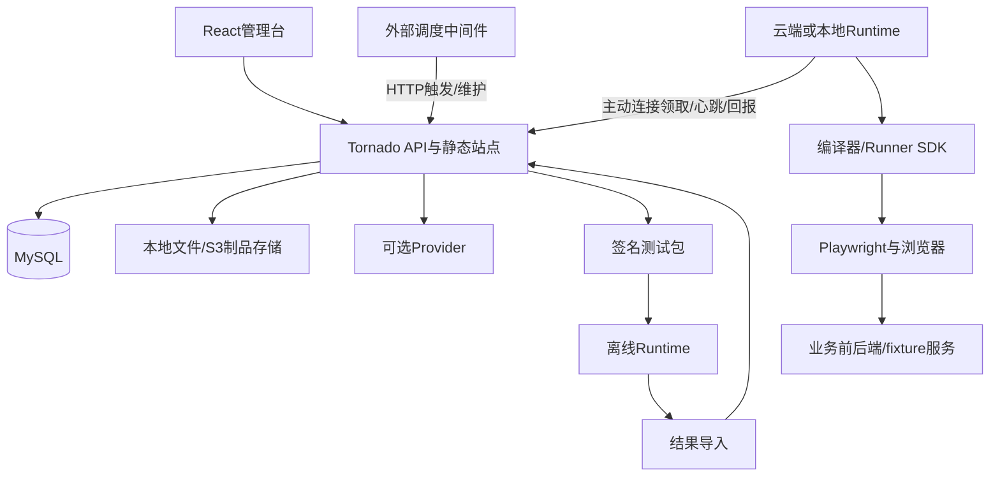

> 已确认补充：桌面GUI属于完整MVP，采用Electron方向；见 [桌面规格](desktop.md)。桌面规格覆盖本文中CLI入口/薄原生启动器的过时候选，不另引入Rust桌面壳。

# VeriQ 1.0 需求与技术规格（审阅稿）

日期：2026-11-10。本文统一替代前序方案中冲突的技术与范围描述，配套实施任务见docs/plans/veriq-1.0.md。本文用于审阅后开展AI编码，不表示产品已实现、构建或通过测试。

## 1. 产品目标、范围与交付标准

VeriQ是面向企业PC Web系统的自动化冒烟与回归平台。模型按需辅助生成用例与分析；常规执行使用固定版本的Playwright TypeScript，不调用模型。适用初始规模：20名以内使用者，同时提交10个以内Run。

首个MVP即完整可安装使用的1.0产品，必须交付下列全部模块。内部研发按依赖分阶段，不将阶段性闭环当作MVP交付，也不以假数据页面、空接口或TODO替代功能。

| 编号 | 模块 | 1.0必须具备 |
|---|---|---|
| F01 | 安装与系统初始化 | 文档化部署、数据库迁移、管理员创建、配置校验、健康检查、示例资源 |
| F02 | 自有用户 | 登录/退出、邀请或管理员创建、密码重置、禁用、会话撤销 |
| F03 | Workspace | 一项目一Workspace、多空间成员、角色、切换、资源隔离、审计 |
| F04 | 页面与元素 | testId/role定位、记录key、作用域、目录版本、引用影响 |
| F05 | 用例 | 步骤编辑、JSON编辑、数据驱动、变量、公共流程、草稿、校验、发布、差异、归档 |
| F06 | 操作与断言 | UI、URL、请求、响应、JSON字段/Schema、持久化、最终一致、模板版本与预期依据 |
| F07 | 环境与身份 | 前后端地址、域名约束、语言时区、业务角色、凭证引用和构建版本 |
| F08 | 测试数据 | fixture契约、隔离准备、结果查询、幂等清理、崩溃补偿 |
| F09 | Runtime | 云端/本地、设备注册、能力自检、私有/共享、授权撤销、实际进程命名 |
| F10 | 执行 | 手动、HTTP触发、队列、容量、租约、心跳、取消、重跑、整用例重试 |
| F11 | 报告 | 实时进度、步骤/断言差异、请求关联、截图、Trace下载与本地查看、历史与门禁、JUnit |
| F12 | 本地离线 | 依赖闭包导出、签名校验、本地凭证、独立执行、离线报告、幂等导入、来源标识 |
| F13 | AI辅助 | 可配置Provider、连接校验、结构化草稿、审核、失败分析、预算与调用记录 |
| F14 | 产品运维 | 同源发布、升级、备份恢复、保留期、日志指标、第三方许可、完整手册与验收报告 |

AI模块开箱提供完整配置和操作引导；实际模型调用使用用户配置的有效Provider，不承诺无API Key也能产生模型输出。无模型时全部确定性执行正常工作。示例业务应用与测试数据随产品提供，真实业务系统仍需按接入契约配置身份和fixture。

收费、支付、订阅、移动端、任意上传代码执行、复杂视觉基线与跨端双向编辑同步不是已确认需求。商业商品标准体现为完整功能、安装、交互、权限、升级、运维与质量；如需增加上述能力须单独列入范围。

## 2. 已确认约束与本稿推荐基线

- 名称VeriQ，技术标识veriq；全部平台物理表以veriq_开头，包括迁移版本表。
- 后端Python3.12、Tornado 6.6.1、SQLAlchemy2.0、MySQL8.4 LTS；精确补丁与镜像摘要在依赖冻结时记录，不跨系列静默升级。
- 前端React18、Vite6、Tailwind3、ESM、react-router-dom7.18.5、TanStack Query5、Radix/CVA、i18next；按需使用dnd-kit与DOMPurify。
- 一项目一Workspace，用户可加入多个Workspace。项目资源、证据和导出均做服务端归属授权。
- 控制服务可在没有Chrome/Playwright运行条件的环境部署；浏览器在独立Runtime运行。
- 业务定时由外部中间件调用HTTP触发；平台不实现Cron解析、计划扫描或APScheduler服务。
- 开发时前后端分开启动；生产先构建前端，复制到后端包static/dist，再统一发布。
- 所有已确认模块在首发版本可用；第三方包候选不要求全部集成同类能力。

本稿按“自建Tornado控制面、复用成熟组件、不fork整站”编制，审阅确认后作为实施基线。代码包采用Node24LTS与Playwright Test，Python后端不运行TS浏览器测试。服务端目标仍为Linux x64。2026-11-14用户明确将macOS Intel x64、Apple Silicon arm64纳入完整MVP并设为最高优先级；Windows11 x64、Ubuntu24.04 x64仍必须交付、优先级较低。Mac最低版本已确认为macOS15（Sequoia），测试必须使用宿主macOS原生Chrome，Mac停止验收按用户确认的[受控进程停止设计](macos-controlled-stop.md)实施，当前尚未实现或验收，其他OS/arch不自动纳入。

## 3. 开源复用与技术选型

通用能力先采用现成库、通过薄适配接入；自建范围是Workspace授权、测试资产、操作断言配置、不可变版本、Runtime租约、离线包和结果协议。禁止自行设计密码、签名、Cron、浏览器等待、迁移或通用报告引擎。

| 能力 | 推荐 | 对比候选及取舍 |
|---|---|---|
| ORM/迁移 | SQLAlchemy2、Alembic | SQLModel增加抽象；手写迁移框架没有收益 |
| 异步MySQL | asyncmy | aiomysql可替换；同步PyMySQL仅迁移/工具场景 |
| 参数/DSL | Pydantic2、jsonschema、Ajv | Zod适合前端局部表单，不作为另一套DSL来源 |
| 密码/会话 | argon2-cffi、服务端opaque Session | bcrypt可选；JWT不利于小规模即时撤销 |
| 权限 | 固定角色矩阵与SQL归属条件 | PyCasbin用于策略变复杂时；OPA增加独立服务 |
| HTTP/重试 | HTTPX、Tenacity | aiohttp可替换；重试库不能自动重试业务写入 |
| 前端表单/表格 | React Hook Form、TanStack Table | Formik/AG Grid Community作替代；核验高级功能许可 |
| JSON编辑 | Monaco | CodeMirror更轻；主交互仍是表单步骤编辑 |
| 浏览器 | Playwright Test | pytest-playwright/Robot Browser改变TS主路径 |
| 报告 | Playwright HTML/JUnit/Trace | Allure可选；ReportPortal适合另建集中分析服务 |
| CLI/本地目录 | Commander、env-paths | oclif适合复杂插件，当前更重 |
| 日志 | structlog、Pino | 标准logging/Winston可选 |
| 文件锁 | proper-lockfile | 仍须校验进程与路径，不能只信PID |
| 签名/哈希 | cryptography、Node crypto | Ed25519/SHA-256；不自造算法 |
| 制品存储 | 本地文件默认、S3适配可配 | boto3接入S3，初次安装不强制部署额外存储服务 |
| 测试 | pytest、pytest-asyncio、Vitest、Playwright | MySQL集成测试必须使用真实引擎 |
| AI | Provider SDK适配、按需接Midscene | LiteLLM/PydanticAI为候选，不必同时引入 |
| Python打包 | uv、build、Hatchling | setuptools可替换，需验证静态文件和迁移脚本入包 |

产品复用比较：Kiwi(Django)适合测试管理但改Tornado成本高；Multica适合参考daemon/Runtime，但当前许可含品牌等附加条件；MeterSphere偏接口测试且栈不同、许可亦有附加条件；Testkube偏K8s且开源Runner与商业控制面分开；ReportPortal/Allure适合作为报告能力；Midscene适合作为可选AI/工作流能力。整站fork需重新评估框架、数据前缀、品牌和离线协议，不能默认全部符合VeriQ要求。

每个直接依赖建立ADR：版本、许可证、维护状态、兼容性、传递依赖、选择理由、替换接口、POC结果。锁定依赖并提供SBOM和THIRD_PARTY_NOTICES。仓库现有LICENSE采用AGPL-3.0，保持不变。

## 4. 架构与职责



Handler做认证、参数和响应；Service做领域规则和事务；Repository做查询。每个请求/并发任务独立AsyncSession；禁止共享Session、多协程并发使用同事务。打包、哈希、同步SDK等阻塞工作进入受限执行池或独立作业，不阻塞IOLoop。

Runtime是同一Node引擎在不同机器的部署；不建立云端Python Playwright、本地TS的双执行逻辑。HTTPS负责协议，WebSocket仅作唤醒，丢失唤醒由领取轮询补偿。

## 5. 目录与开发/生产模式

```text
veriq/
  apps/
    web/                         # @veriq/web，React/Vite
      src/features/
      dist/                      # 构建产物，gitignore
    srv/
      pyproject.toml
      uv.lock
      src/veriq_server/
        __main__.py
        handlers/ services/ repositories/ models/
        auth/ infrastructure/
        migrations/              # 随wheel发布
        static/dist/             # 前端产物，gitignore，强制入wheel
      tests/
    runtime/                     # @veriq/runtime
    launcher/                    # 本地原生入口的薄封装
  packages/contracts/            # JSON Schema、OpenAPI、样例
  packages/compiler/
  packages/runner-sdk/
  fixtures/demo-app/
  scripts/                       # stage_web、verify_wheel、release、test
  deploy/                        # Dockerfile、compose、start/control等
  docs/{decisions,integration,operations,acceptance}/
  build.sh
  pnpm-workspace.yaml
  pnpm-lock.yaml
  AGENTS.md
```

开发：Vite运行5173，Tornado运行8888，Vite将/api和必要事件连接代理到后端，HMR保留。后端可独立调试；不启用宽泛的credentialed CORS。Runtime另行启动。

生产：Tornado单个对外端口同时提供API和static/dist。Node/pnpm只在构建机使用，服务端镜像不要求Node、pnpm或Chrome。独立Runtime包提供浏览器运行依赖。

## 6. 生产静态资源路由契约

路由顺序：健康/版本 → /api/v1 → /internal/v1 → 静态assets/公开文件 → 登记的SPA路由 → 404。

- /api或/internal未知路径返回结构化404，不返回index.html。
- 缺失JS/CSS/图片返回404，不返回index.html。
- /login、/setup、/workspaces等登记前端路由的GET/HEAD支持深链接刷新；其他未知路径不无限fallback。
- StaticFileHandler只服务发布包目录，防路径穿越；用户上传证据不放static目录。
- index.html不缓存或使用no-cache；带hash的assets使用immutable缓存。
- Web/APIs同源；凭证不注入Vite编译环境或JS产物。
- 正式模式缺index.html时启动失败并提示包不完整；开发模式不强制该目录存在。
- build-info返回非敏感version、commit、buildId、staticManifestHash；版本与前端产物一致。

## 7. 用户、Workspace与授权

自有用户支持邀请/管理员创建、登录、退出、密码重置、禁用与会话撤销。初始管理员通过本机命令或一次性安装凭证创建，不提供固定默认密码。默认邀请可复制一次性链接；SMTP配置后支持邮件发送。重置链接短效、单次使用、令牌只存摘要，不能暴露账号是否存在。

Web使用HttpOnly/Secure/SameSite Cookie和CSRF；设备token与Web Session分离。未来接SSO时映射到内部user_id，不替代用户主体。

角色：OWNER管理所有权，ADMIN管理成员/发布/环境，EDITOR编辑与调试，EXECUTOR执行发布资产和获授权下载，VIEWER查看。最后OWNER不能无替代删除。用户可加入多个Workspace，平台权限和被测系统身份分开。

所有资源操作、批量接口、引用、SSE、证据、导出和导入都校验workspace_id与成员状态。个人Runtime默认私有，所有者显式分享给成员或Workspace；管理员不默认可向私人电脑派单。权限撤销阻止后续领取/下载/上传，在线发取消；离线设备和已下载数据无法保证远程立即回收。

## 8. 数据模型与约束

所有表名前缀veriq_。ID使用UUID字符串；存储UTC DATETIME(6)，显示默认Asia/Shanghai。业务状态和租约用独立列，DSL/快照/差异用JSON。版本内容不可原地修改。

| 分类 | 物理表 |
|---|---|
| 用户 | veriq_users、veriq_user_sessions、veriq_user_tokens |
| 自动化身份 | veriq_service_accounts、veriq_service_tokens |
| 空间 | veriq_workspaces、veriq_workspace_members、veriq_workspace_invites |
| 设备 | veriq_runtimes、veriq_runtime_enrollments、veriq_runtime_bindings、veriq_runtime_grants、veriq_runtime_tokens |
| 资产 | veriq_resources、veriq_resource_drafts、veriq_resource_versions、veriq_resource_dependencies、veriq_validation_receipts |
| 凭证 | veriq_secret_refs、veriq_secret_versions |
| 执行 | veriq_execution_plans、veriq_runs、veriq_case_executions、veriq_jobs、veriq_attempts |
| 结果 | veriq_step_results、veriq_assertion_results、veriq_execution_events |
| 制品 | veriq_artifacts、veriq_bundles、veriq_result_imports |
| 容量 | veriq_capacity_pools、veriq_resource_leases |
| 维护 | veriq_maintenance_jobs |
| 其他 | veriq_ai_generations、veriq_audit_logs、veriq_alembic_version |

资源kind：CASE、ELEMENT_CATALOG、ASSERTION_TEMPLATE、DATASET、FLOW、FIXTURE、SUITE、ENVIRONMENT。统一资源注册/版本表减少重复CRUD，文档按kind分别Schema校验；执行结果使用关系表便于查询。

主要字段：resource(id,workspace_id,kind,key,name,status)；draft(resource_id,revision,document_json,updated_by)；version(resource_id,version_no,schema_version,document_json,sha256,published_by)；Run(workspace_id,source,snapshot_hash,state,outcome,idempotency_key)；Job(workspace_id,kind,subject_id,snapshot_hash,state,required_capabilities,active_attempt_id)；Attempt(job_id,case_execution_id可空,attempt_no,runtime_id,lease_token_hash,fencing_token,lease_expires_at,phase,outcome)；assertion_result(attempt_id,step_id,assertion_id,expected_json,actual_json,status,error_code)；bundle(workspace_id,snapshot_hash,engine_version,manifest_hash,signature,exported_by)。

veriq_jobs为统一Runtime领取队列，kind=TEST/VALIDATE/CLEANUP。TEST关联CaseExecution，VALIDATE关联不可变草稿校验快照，CLEANUP关联维护记录；三类共享授权、租约和终态协议，manifest采用按kind区分的联合类型。只有需要浏览器的任务占浏览器容量，编译与清理各有独立并发配额。不另外实现三套领取循环。

唯一约束：空间+kind+key；资源+version_no；空间+幂等键；Attempt+sequence；Attempt+step+assertion；空间+bundle+localRunId。跨资源引用使用空间组合约束和服务校验。普通资源归档不释放key。Alembic配置version_table="veriq_alembic_version"。

MySQL统一InnoDB/utf8mb4，UUID和机器key采用区分大小写的ASCII或binary排序，普通文本使用声明的Unicode排序；连接time_zone='+00:00'，队列事务采用READ COMMITTED并测试死锁重试。doctor与迁移入口拒绝不支持SKIP LOCKED的旧MySQL。服务账号独立于员工登录，令牌授权到Workspace/计划/维护操作，不能以“知道planId”取得权限。

## 9. 契约、资源版本和编译

packages/contracts提供case、catalog、fixture、snapshot、event、attempt-manifest、bundle、offline-result的v1 JSON Schema及OpenAPI。Python与Ajv使用同组正反样本，OpenAPI生成Web/Runtime客户端。

草稿携带revision更新，冲突409；校验结构、引用、变量、模板版本、关键断言、流程环和限制。发布前由获授权Runtime针对资产hash进行编译验证，保存引擎版本与回执；变更草稿使旧回执失效。无Runtime可编辑和导出调试包，不能伪称已验证发布。

发布固定用例、目录、模板、流程、数据集、fixture及编译器版本；Run创建时额外冻结环境、角色、浏览器、数据行与应用build SHA。执行不读取最新版资产。DSL为可编辑源，生成TS为产物；下载包包含实际TS/SDK/锁文件，可脱离平台复现。

编译器compileAssets(AssetSnapshotV1)生成CompiledAssetBundle，Runtime在VALIDATE任务上传实际TS、依赖清单、文件manifest、sourceHash与验证回执；控制服务校验后保存制品，正式发布/导出复用，服务端不需要Node。assembleExecution(bundle, ExecutionSnapshotV1)附加环境/数据/运行上下文，不静默改写已验证源码。无Runtime导出的草稿调试包仅含DSL及依赖定义，标记unvalidated，本地先编译，不能冒充包含已验证TS的发布包。

相同资产快照和引擎产生一致代码hash；运行ID、机器路径等通过独立上下文注入。JSON拒绝NaN/Infinity，整数不超过跨语言安全范围，业务大整数用字符串。

## 10. 操作、断言与变量

步骤字段：id、action、target/path/value、critical、beforeAssertions、observers、afterAssertions、extract、timeoutMs、failurePolicy。动作包括goto/click/fill/check/uncheck/press/selectOption/upload/reload/apiRequest/callFlow，弹窗、新页、下载监听按相同先注册原则实现。自定义Radix下拉用公共流程，不误用原生selectOption。

断言：UI状态/文本/值/数量、URL、请求方法路径参数、HTTP状态、业务码、JSON Pointer字段与Schema、持久化、最终一致查询、粗粒度耗时门槛。JSON字段采用RFC6901 Pointer，不在1.0开放JSONPath表达式求值。关键写入步骤须业务结果断言，写用例须指定持久化检查点。

每条断言保存id/type/source/operator/expected/timeoutMs/severity/expectedSource。visible等状态断言预期为boolean；httpStatus为integer；字段equals按JSON类型严格比较；缺失路径是MISSING而非null。severity为BLOCK、CONTINUE_FAIL、WARN；关键业务不可随意降级WARN。所有断言默认AND。

顺序：前置校验→唯一定位→安装监听→动作→关联响应与基础断言→提取→依赖断言→观察窗口检查→释放。匹配至少方法+精确路径+必要query/body+本次业务key；不能用includes路径或任意成功响应。监听在动作前安装，所有分支dispose且无未处理Promise。精确次数仅对定义的观测窗口有效；合法重试策略显式配置。

变量包括data、fixture输出、vars和secretRef。完整占位符保留类型，缺失立即失败。fixture声明输入/输出Schema；提取先验证响应再赋值。流程固定版本，最大深度5、展开500步，禁止递归和eval。每个数据行独立执行。预期来自需求/API/受控数据/人工审核，模型不能复制当前实现当真值。

UI采用Playwright自动等待；最终一致每500ms只读查询、默认总限10秒，可配置。禁止轮询内重复写入，禁止固定sleep和force click掩盖失败。不可见按钮仍需后端越权请求验证。

## 11. 执行状态、容量、租约和取消

Run包含CaseExecution(版本×数据行×角色×浏览器)，后者包含独立Attempt。Run state为QUEUED/RUNNING/CANCEL_REQUESTED/FINISHED；outcome为PASSED/FAILED/ERROR/UNSTABLE/CANCELLED/INCOMPLETE。Attempt phase为LEASED/PREPARING/RUNNING/CLEANING/FINALIZING/FINISHED，另存业务/清理结果及最终outcome。

Job state为QUEUED/LEASED/RUNNING/CANCEL_REQUESTED/FINISHED；CaseExecution state为QUEUED/RUNNING/FINISHED。等待设备/容量等存waitReason(RUNTIME_OFFLINE/NO_CAPABILITY/CAPACITY/RESOURCE_LOCK/QUARANTINED)，WAITING_FOR_RUNTIME仅是界面展示，不另造状态。重试时Job回QUEUED，新建Attempt，旧Attempt终态不变。

结果归约固定为ERROR > INCOMPLETE > FAILED > CANCELLED > UNSTABLE > SKIPPED > PASSED。Run额外支持SKIPPED用于计划重叠策略；Attempt不使用UNSTABLE，只有Job/CaseExecution/Run汇总重试历史后生成。业务通过但清理失败=ERROR/CLEANUP_FAILED；失联=ERROR/WORKER_LOST；关键证据不全=INCOMPLETE；明确取消且最小取消记录齐全=CANCELLED；取消同时证据缺失=INCOMPLETE；零用例=INCOMPLETE/NO_CASES_SELECTED；已知BLOCK后的依赖跳过如实登记，不另冒充丢事件。预期完成且全部必需内容通过才PASSED。原始业务/清理/证据结果均保留，不能只存最高优先级字符串。

默认最多10个未结束Run，在线全局4个浏览器上下文，单Workspace2个，离线本机1个。容量与环境/账号/数据锁共同限制。默认Run重叠策略QUEUE，支持SKIP/REJECT，跳过不代表通过。

MySQL短事务按固定顺序锁global/workspace/runtime/environment容量和资源，再用FOR UPDATE SKIP LOCKED领取；分配Attempt、令牌与容量原子提交。禁止count后无锁启动。心跳10秒、租约60秒，使用服务端时间。每次领取递增fencingToken；心跳、事件、上传与finish检查当前有效租约，旧结果不得覆盖新Attempt。

失联标记WORKER_LOST。写入结果未知先用业务key/幂等键查询，不盲目重发；数据库队列不承诺业务副作用恰好一次。重试由VeriQ统一，生成Playwright retries=0；默认不重试业务失败，最多1次整用例重试，新Context、新fixture、新工作目录。首次失败重试通过=UNSTABLE，默认门禁不通过。

超时：动作10秒、UI5秒、网络15秒、准备60秒、业务120秒、独立清理30秒、Run30分钟。嵌套等待受剩余总预算限制。

取消先标记并停止新领取，Runtime中断操作、取消监听、清理，再按平台已确认范围验证停止后释放容量：Linux/Windows保留全部后代排空证明；Mac核验受控Worker/Chrome退出，不承诺任意游离后代内核级全清理，具体登记、回执与恢复见[Mac停止设计](macos-controlled-stop.md)。无法确认停止时保留未知/失联状态和补偿，不直接标成功或安全重派。联网Runtime丢租约停止，不自动改离线继续。租约过期撤销结果写入权，但不证明原进程已经停止：对应设备/容量/独占资源进入QUARANTINED，收到停止证明或管理员审计解除后才复用；不通过盲目回收slot掩盖可能仍在运行的浏览器。

## 12. HTTP触发与维护

执行计划仅保存suite/environment/角色/浏览器/Runtime选择/重叠策略，不保存平台解释的Cron。外部中间件调用：

```http
POST /api/v1/workspaces/{ws}/execution-plans/{plan}/trigger
Authorization: Bearer <scope-limited-token>
Idempotency-Key: <本次外部触发唯一键>
```

鉴权、冻结快照、入队，首次202返回runId；相同键同参数返回原runId，不同参数409。重复外部重试复用键，新触发用新键。调用方通过GET runs/{id}查结果，不保持长HTTP。提交不允许任意覆盖未授权环境、凭证和代码。

TriggerReceipt包含decision(ENQUEUED/REUSED/SKIPPED)、runId、statusUrl。SKIP创建FINISHED/SKIPPED的轻量Run并返回200及OVERLAP_SKIPPED原因，不创建执行Job；REJECT返回409；QUEUE受容量约束，超出待处理上限返回429。相同键重试始终指向同一记录，不把跳过当通过。

外部维护接口：POST /internal/v1/maintenance/expired-leases/reap、fixture-cleanups/reconcile、artifacts/expire。受限身份、有界批次、幂等、返回处理数与hasMore，部署包附外部调度配置示例和健康监控。需要业务内网的清理生成maintenance_job，由有能力Runtime领取。没有内部业务Cron，但不能删除租约和清理机制。Agent轮询、心跳不是Cron。

## 13. Runtime分发、命名与设备授权

原生入口veriq/veriq.exe；后台veriq_agent；执行veriq_runner。要求OS实际进程名，不能只改日志。推荐薄原生启动器配锁定Node运行文件及ESM代码；Node副本按角色名称分发，保留许可，Playwright worker继承相应execPath。Windows进程树和Linux进程组都要实测；浏览器与开发工具沿用原生名。SEA作为可选方案，不在未验证动态依赖前假定可用。

绑定流程：CLI发设备码→用户确认设备、空间和共享范围→短效/可轮换设备凭证→doctor检测OS/arch/Node/SDK/浏览器/网络→上线。设备token最小权限、只存摘要/本地安全存储，撤销可查。私人设备分享由owner控制。任务匹配空间、设备授权、引擎、浏览器、网络和容量；无合适设备显示WAITING_FOR_RUNTIME，不静默换机。

CLI：login/logout；workspace list/use；runtime start/status/stop；doctor；bundle download；run --offline；results upload；trace open。每条都有help、退出码、日志定位与错误恢复文档。命令参数以数组spawn，不执行用户shell字符串。

云端Runtime使用同一Linux发行包和独立含浏览器镜像，提供Compose可选runtime profile及systemd示例。部署账号经短效一次性登记凭证注册，持久化设备身份和信任配置；控制服务镜像仍无Node/Chrome。trustStatus只能由系统管理员在设备所有者已授权共享的范围内授予，客户端不得自报。MANAGED_CLOUD/CONNECTED_LOCAL是执行位置，MANAGED/USER_REGISTERED/REVOKED是独立信任等级。私人本地设备也可经正式授权成为MANAGED，云端位置本身不自动可信。撤销不改历史outcome，当前门禁重新检查可信策略；历史gateAtExecution与当前gateNow分别显示。

## 14. 离线包、凭证与结果来源

包包含manifest、资源依赖闭包、非敏感数据、fixture定义、环境公开配置、引擎清单/锁文件、入口、实际生成TS及结果目录。平台签manifest精确字节，manifest列文件SHA-256；验证后解压，限制路径/链接/体积/文件数。

验签信任根来自经过认证的HTTPS设备绑定或管理员带外分发并核对指纹的issuer公钥，存Runtime配置；不从待验证包中自我建立信任。manifest携带issuerId/keyId；轮换经可信旧key链或重新认证绑定接受，记录缓存撤销列表。离线时不能得知最新撤销，报告标记撤销状态未知；已知撤销key硬拒绝，过期包只允许显式DEBUG覆盖且不能通过正式门禁。安装包签名用于验证发行程序，与企业自托管平台的测试包issuer根分开。

普通包无密码、Cookie、storageState、设备token、清理令牌。secretRef在本地OS凭证库或受限配置中映射。缺凭证明确失败。baseURL/fixture地址覆盖要授权并记录实际环境，不能冒充原环境。首期下载只读快照，本地改动dirty，重新提交草稿而不自动双向同步。

独立模式执行不连接平台，但仍需业务系统可达。全离网依赖OS/arch离线安装包；不同系统不共用node_modules。localRunId独立产生，本地报告可用，恢复连接后上传。导入检查当前权限、包来源/签名/hash、版本、结果Schema和制品，幂等键(ws,bundle,localRunId)。新建OFFLINE_IMPORT，不覆盖线上Attempt。

来源MANAGED_CLOUD/CONNECTED_LOCAL/OFFLINE_IMPORT；另存设备trustStatus、dirty、实际配置。包签名不证明本地结果绝未被伪造，正式门禁默认仅受管理设备。断网时无法保证远程取消、权限即时回收和跨机并发上限。

## 15. 报告、制品和AI

事件按Attempt内sequence递增，本地有界缓冲、批量回传和重放去重，SSE按cursor补读。finish带lastSequence和证据manifest；缺关键事件/证据为INCOMPLETE，不由退出码0推导全绿。

报告展示版本、来源、预期依据、实际/预期差异、请求关联、各Attempt、耗时、环境/浏览器、清理和证据状态。错误至少区分断言、定位缺失/歧义、网络超时、契约、准备、认证、环境变化、失联、清理、上传和结果不全。首次通过率、重试通过率、基础设施错误分开统计。

结构化报告由VeriQ展示；复用Playwright HTML/JUnit/Trace。原始HTML按受限制品下载或sandbox隔离查看，不把不可信导入HTML直接作为同源脚本运行。Trace支持授权下载及veriq trace open本地查看，不默认上传公网。Trace可能含业务数据，不能认为日志脱敏等于Trace脱敏。原始Trace不直接送模型。

AI完整提供Provider配置/连接测试、需求+OpenAPI+元素+数据生成草稿、校验/审核/调试/发布、边界建议、脱敏失败分析、调用历史、token/费用与预算。关闭Provider不影响执行；预算耗尽只停生成。模型输出不能自动发布、修宽断言或读取密钥。

## 16. 被测前后端接入要求

前端testId表达业务语义，覆盖关键交互、结果、错误、加载/空态；重复行结合稳定recordKey，不用随机数/数组下标/翻译文案。Radix Trigger/Content和Portal单独锚点；CVA/asChild透传属性/ref。TanStack Query的后台请求不能误配，乐观更新须持久化验证；i18next固定locale/timezone；dnd-kit采用稳定目标和键盘优先；DOMPurify不为测试放宽清洗。

Java/Python后端均以HTTP接入，提供固定OpenAPI、角色与正常认证、fixture准备/查询/cleanup、requestId和build SHA。fixture幂等、每Attempt独立namespace、UI创建资源可精确归属、finally和TTL补偿；同key不同参数409；清理重复安全且不能触碰其他fixture。测试支持仅在受控环境鉴权开放。权限测试使用普通业务身份。所有地址从实际Runtime可达。

## 17. 统一API协议

外部/api/v1，设备内部/internal/v1；Web Cookie/CSRF，自动化token，设备token分别授权。成功含data/requestId；错误含稳定code/message/details/requestId。未知API返回JSON404。

资源：/workspaces/{ws}/resources、draft、validate、publish、versions、dependents。空间成员、环境、凭证引用、Runtime、execution-plans、runs、bundles、result-imports、ai/generations、audit分别有完整API。修改draft用revision；列表有分页、筛选和稳定排序；导出支持流式传输与限额。

设备内部claim/heartbeat/events/artifact-uploads/finish固定契约，claim返回attempt、snapshot URL/hash、leaseToken、fencingToken、expiresAt。制品通过受控上传/下载，磁盘key由服务端生成，不接受任意文件路径。

租约过期后设备可用自身有效身份调用POST /internal/v1/attempts/{id}/reconcile提交本机停止/清理事实；此接口仅用于核对QUARANTINED容量，不允许补写旧业务成功结果。验证设备/原Attempt绑定后接受停止回执；无法核实则由授权管理员审计解除。

## 17A. 业务凭证的在线/离线解析

环境版本将roleKey映射到认证适配器版本、secretRef和允许的身份范围。Run冻结secretVersionId引用而非明文；已撤销版本不能继续发放，返回CREDENTIAL_REVOKED，不自动换成新密码改变快照含义。secret版本用cryptography AES-GCM加密、随机nonce及空间/引用/版本AAD，主密钥外置、标keyId并支持轮换。

受管理云端Runtime可在授权环境内通过POST /internal/v1/attempts/{id}/credentials/resolve领取任务所需值，校验成员/服务身份、环境角色、Runtime允许列表、trustStatus和有效lease/fencing。默认个人联网Runtime只使用本地映射；管理员显式授权设备后才可接收平台凭证。离线只用本地映射，包中不含凭证。配置UI提供创建/更新/撤销但不回显原文。

解密仅在本Attempt需要时进行，TLS下发、只传必需字段，不写快照/普通事件/命令行。storageState保存在受限Attempt临时目录并在结束清理；设备token不继承给测试业务子进程。普通API调用和权限验证使用相应业务身份，fixture使用独立最小服务身份。已下发长期业务密码无法保证从恶意设备远程擦除，因此共享设备和密钥下发必须显式授权，优先使用短期业务会话。

## 18. 构建、打包和发布的强制契约

构建入口./build.sh，默认完整测试；--with-tests同默认；--skip-tests必须附--reason，始终保留类型/lint/格式/打包完整性检查，release.json明确标testsSkipped和原因。常规release CI拒绝跳过测试的包；紧急包另行留痕，不能伪称已验证。

构建顺序：

1. 检查Python3.12、uv、Node24、精确pnpm和锁文件；缺工具明确失败，不往用户HOME静默安装。
2. pnpm install --frozen-lockfile；@veriq/web check（tsc、lint、格式）后vite build；校验apps/web/dist/index.html和manifest。
3. scripts/stage_web.py将dist复制到apps/srv/src/veriq_server/static/dist；目标严格白名单，先清理旧资源，拒绝危险路径，避免旧hash资源混入。
4. uv sync --project apps/srv --frozen --all-groups；后端ruff/mypy等检查；默认Python/TS单测、真实MySQL集成、合同和生产同源E2E门禁。
5. build和Hatchling放锁定build依赖组；明确使用同步的uv环境产wheel：uv run --project apps/srv --frozen --all-groups python -m build --wheel --no-isolation apps/srv --outdir work/server-wheel。不能用未激活环境的裸python误调系统解释器。
6. verify_wheel.py打开wheel确认index.html、完整assets、迁移、版本与依赖清单存在；在干净环境安装wheel，启动生产模式并测试深链接/API404/静态404/无Node运行。
7. 生成部署包、启动/安装脚本、示例配置、Dockerfile/Compose、数据库初始化/迁移命令、操作文档、SBOM、NOTICE、sha256sums和release.json。
8. 所有步骤成功后原子写入output/server，失败不留下标记为成功的发布包。临时目录使用work/；禁止无保护rm -rf变量目录。

Hatchling必须区分开发editable安装和正式wheel构建：开发安装不要求已有前端dist；正式构建缺dist/index.html必须失败。不能把无条件force-include直接用于两种模式，否则第一次uv sync可能因目录不存在而失败。

```toml
[tool.hatch.build.targets.wheel]
packages = ["src/veriq_server"]
exclude = ["src/veriq_server/static/dist/**"]

[tool.hatch.build.hooks.custom]
path = "hatch_build.py"
```

apps/srv/hatch_build.py继承Hatchling BuildHookInterface：editable版本不注入静态目录；正式wheel检查index与manifest后，向build_data.force_include登记static/dist→veriq_server/static/dist。显式exclude防止默认遍历与强制映射重复。若发布sdist，hook将相同产物映射到源码相对路径并随源发行打包。以干净checkout的editable安装、正式wheel和无.git源码构建三种场景测试，不只看开发目录能启动。

同样验证migrations和示例资源随wheel发布。后端包目录只读，日志/制品/状态写配置的数据目录。Python发行不套用jar语义；可交付含wheel与依赖wheelhouse的tar包及OCI镜像，均包含同一前端产物。服务端启动采用python -m veriq_server serve。

正式服务端产物：output/server/veriq-server-<version>-linux-x64.tar.gz、wheel、release.json、sha256sums、SBOM、NOTICE、部署资料。依赖wheelhouse按Python3.12/OS/arch及运行ABI生成，在对应运行基础镜像或兼容manylinux环境制作并实测；不能把构建宿主的原生依赖直接搬入另一发行版。裸包基线Ubuntu24.04 x64，容器按固定Python3.12运行基础镜像单独验收。

Runtime产物在对应Windows/Linux构建与测试job产生，含原生入口、角色Node运行文件、编译器/SDK/依赖、浏览器安装或离线资源、NOTICE、hash和安装说明，写output/runtime。服务器build不声称在Linux上已经验证Windows包；发布流水线汇总全部平台验证结果。原生可执行包签名由正式发布凭证注入，开发测试签名与正式签名区分。

默认Python可执行代码行与TS核心包行覆盖率各>=75%，关键状态/权限/错误恢复场景必须独立测试；generated/static/第三方不计入覆盖分母。缺MySQL/浏览器测试条件时默认构建失败，CI可将测试与打包分job但必须绑定同一commit/锁文件/静态manifest证据，不能自动跳过。

## 19. 安装、配置、升级与运维

开箱提供两种服务端安装：Docker Compose（API+MySQL，制品默认volume）和Python3.12部署包（venv+wheelhouse）。独立本地Runtime提供Mac双架构优先及Windows/Ubuntu的安装卸载、登录或开机启动/停止说明。Compose的可选demo profile包含示例业务与fixture；初始化向导导入示例Workspace/目录/套件，并按Runtime实际网络映射URL。

配置优先CLI > VERIQ_环境变量 > 配置文件 >默认。默认仅非敏感值；DB、加密主密钥、签名密钥和对外URL必须显式配置或通过安全安装流程生成。主密钥不存数据库或静态文件；密钥丢失的恢复影响写入手册。

初始化流程：配置预检→备份/迁移数据库→创建管理员→配置制品目录/存储→启动同源站点→绑定Runtime→自检与示例执行。单实例开发可显式执行迁移；多实例生产由单独迁移job，不能每个API实例无锁并发迁移。

升级前备份DB、制品和所需密钥；验证版本/Schema兼容和Runtime最低版本。回滚二进制仅在DB兼容时允许，破坏性迁移需提供备份恢复或向前修复方案。升级不覆盖外置配置和用户数据。提供安装包版本、数据库版本、Runtime版本的兼容矩阵。

监控队列、容量、心跳、过期租约、事件积压、清理、存储与模型成本；liveness不因DB短暂不可用就宣称进程死亡，readiness检查DB/关键依赖/static。默认元数据90天、失败证据30天、成功包14天，可配置；外部维护接口回收。

## 20. 产品质量与验收

必须具备全部菜单、真实API、权限、空态/加载/错误/成功、表单校验、版本冲突、进度重连和可恢复错误。按钮不可只有外观；演示数据不能替代真实后端。默认中文，提供英文资源，布局满足PC1280宽及以上，操作可键盘完成关键路径。

功能验收覆盖F01-F14；并发验收同时10Run、默认不超过4上下文/空间2；故障验收快速响应、业务失败、未持久化、歧义定位、失联、迟到回报、取消、清理/证据失败；权限覆盖跨空间和私人设备；离线覆盖无平台执行、缺凭证、篡改、重复导入；生产打包覆盖wheel真实安装与深链接。

完整验收不依赖模型Key，但AI Provider通过mock协议与至少一个经授权实际Provider分别验证，真实调用数据/成本如实记录。真实业务接入5～10条关键流程至少5轮，保留首次失败和修复证据，不将轮次当统计可靠性证明。

最终交付：源代码/锁文件/迁移/契约、服务端包与镜像、两平台Runtime包、示例工程和数据、完整用户/接入/管理员/运维/故障手册、第三方许可清单、真实测试报告与已知限制。达到全部验收后才标记1.0完成。

## 21. 参考与审阅决策

推荐路线是自建薄控制面，非整站fork；当前候选和参考不等于依赖已冻结。审阅需确认：VeriQ自身许可、支持OS/arch、具体库候选、Runtime原生封装与正式签名、部署环境及外部调度接入。用户明确约束无需重复确认，例Tornado 6.6.1、外部HTTP触发、前端随Python包发布。

参考：https://www.tornadoweb.org/en/stable/ 、https://docs.sqlalchemy.org/en/20/ 、https://playwright.dev/docs/intro 、https://hatch.pypa.io/latest/config/build/ 、https://github.com/multica-ai/multica 、https://github.com/kiwitcms/Kiwi 、https://github.com/reportportal/reportportal 。第三方许可以选定tag及路径为准。

## 附录A：关键执行协议

```json
{
  "runnerId":"uuid",
  "clientRequestId":"uuid",
  "availableSlots":1,
  "capabilities":{"engineVersion":"1.0.0","os":"win32","arch":"x64","browsers":["chromium"]}
}
```

claim服务端以注册配置为准，不信任availableSlots自行扩大授权。响应204表示无任务；成功返回jobId、jobKind、attemptId、leaseToken、fencingToken、expiresAt、snapshotUrl、snapshotSha256。claim请求ID幂等，网络响应丢失后通过同请求ID或设备恢复协议核对既有租约，不能再次派出同一业务执行。令牌恢复必须使旧令牌失效并记录。

heartbeat输入令牌与fencing和progress，返回leaseExpiresAt/cancelRequested；已过期令牌不能复活。events含sequence/type/timestamp/stepId/assertionId/payload，服务端确认连续接收位置。finish含kind、outcome、manifestSha256、lastSequence、cleanupStatus；初次提交需有效租约，已经成功提交的同manifest幂等重试返回原回执，即使此后租约已结束；不同manifest不得覆盖终态。

## 附录B：DSL规范示例

示例fixture声明输出employeeCode并由SDK以类型校验写入vars；数据行声明name；提取声明employeeId，业务请求仅包含code/name字段，变量employeeCode映射到请求code。pointer严格采用RFC6901，source分request/response，禁止任意表达式。

```json
{
  "schemaVersion":"1.0",
  "caseKey":"employee-create",
  "title":"新建员工并确认持久化",
  "kind":"WRITE",
  "roleKey":"hr-editor",
  "catalogVersionId":"11111111-1111-4111-8111-111111111111",
  "fixtureVersionId":"22222222-2222-4222-8222-222222222222",
  "datasetVersionId":"33333333-3333-4333-8333-333333333333",
  "persistenceCheckpointStepId":"confirm",
  "steps":[
    {"id":"open","action":"goto","path":"/employees/new"},
    {"id":"name","action":"fill","target":"employee.form.name","value":"{{data.name}}"},
    {"id":"code","action":"fill","target":"employee.form.code","value":"{{vars.employeeCode}}"},
    {
      "id":"save","action":"click","target":"employee.form.save","critical":true,
      "observers":[{"id":"create","method":"POST","path":"/api/employees","bodyMatch":{"code":"{{vars.employeeCode}}"},"timeoutMs":15000}],
      "afterAssertions":[
        {"id":"http","type":"httpStatus","source":"response:create","operator":"equals","expected":201,"severity":"BLOCK","expectedSource":"API-EMPLOYEE-1"},
        {"id":"business","type":"responseField","source":"response:create","pointer":"/code","operator":"equals","expected":0,"severity":"BLOCK","expectedSource":"API-EMPLOYEE-1"}
      ],
      "extract":[{"source":"response:create","pointer":"/data/id","to":"employeeId","valueType":"string","required":true}]
    },
    {"id":"detail","action":"goto","path":"/employees/{{vars.employeeId}}"},
    {"id":"confirm","action":"reload","afterAssertions":[{"id":"persisted-name","type":"ui","target":"employee.detail.name","operator":"textEquals","expected":"{{data.name}}","timeoutMs":5000,"severity":"BLOCK","expectedSource":"REQ-EMPLOYEE-1"}]}
  ]
}
```

正式示例工程提供对应目录/fixture/数据集；跨Workspace导入示例时生成新UUID并重写依赖。JSON Schema对每种action/type用oneOf限定字段，additionalProperties=false；timeout缺省使用正文值。observer先等首个候选以执行断言，窗口关闭时再确认歧义/次数；窗口策略显式写入正式Schema与报告。没有精确计数需求时不宣称验证了完整时间范围的请求次数。
